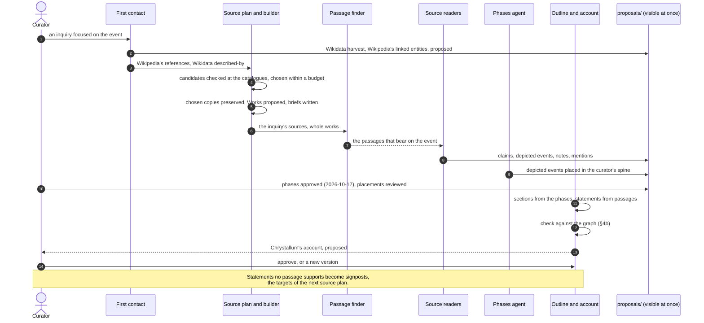

# 29 — Event-Centred Inquiry and Chrystallum's Account

**Date:** 2026-10-15, updated 2026-10-16. **Status:** decisions agreed with
the curator (§2, §4a, §7, §10). Built: Wikipedia first contact, the source
registry, the shared reading rules, computed scope, source briefs, the event
source plan, the inquiry builder, and the passage finder; all nine sources
read (§9a). Not built: the battle's phases and Chrystallum's account (next).
**Changes:** [25](25-LIVES-AND-PLAYGROUND.md) §7 rule "from the graph only"
(§4 here), the legacy lesson "Wikipedia is orientation only"
([16](16-LEGACY-TRIAGE.md), biographic row; §5 here), and the order of next
steps in [19](19-SESSION-HANDOFF.md) §6 (§9 here).
**Builds on:** 25 §13 (agents choose the sources), [26](26-UI-DATA-CONTRACT.md)
§4 (signposts) and §5 (narrative), [28](28-SUBJECT-BUCKETS.md) (buckets),
[docs/Agent resources.md](docs/Agent%20resources.md) (the seed list), and two
Perplexity documents: [Weaving Neo4j Work Annotations into an Actium
Narrative](docs/Weaving%20Neo4j%20Work%20Annotations%20into%20an%20Actium%20Narrative.md)
and [Perplexity Session on Architecture](docs/Perplexity%20Session%20on%20Architecture.md).

## 1. Why

The graph has been driven by works. Every inquiry names one Work (Plutarch's
*Antony*, Dio 50–51, Hale, Weigall), its guidance is written for that Work,
and the battle is what is left when the four are put side by side. That was
the right way to test the reader one source at a time. It is not how a user
meets history: they start from the battle.

The curator (2026-10-15): with the Battle of Actium on the centre stage, the
user should also see an **agent-generated account** of it, well written, that
references the works properly, built from Wikipedia and from as many sources
as the agent finds on its own.

## 2. Decisions (curator, 2026-10-15)

1. **An inquiry focuses on an entity, here an event.** An inquiry names what
   it is about, not a Work; the agent gathers the works for it. Its focus may
   be an Entity of any kind: an event, a person, a place, an object, a group,
   an office, a period (curator, 2026-10-17). This document is the event's
   case. (Reworded 2026-10-17, 1f2(b); first written "the event is the
   inquiry".) The focus is what happened, or who or what existed; the inquiry
   is the research about it: a question, a scope, a plan, its runs, and the
   curator's decisions. Several inquiries may share a focus (the naval
   campaign, the battle's memory), and one inquiry may have several. The data
   already said so: an inquiry file names its event by `narrativeEventId`. The
   contracts are in [31](31-ONE-COMMAND.md) §3.11.
2. **Chrystallum's account sits on the stage beside the event**: a narrative
   written by the agent, labelled as ours, every statement citing a passage.
3. **Wikipedia is a starting point**: for the agent, to surface the high-level
   people, places, and events; for the user, as a link from the event's card
   to its Wikipedia article.
4. **Facets are lens steps in the drill-down path**, never stored nodes (as
   decided in 25 §12). The breadcrumbs may read "Roman Republic › Military ›
   Civil War › Battle of Actium", where "Military" is the lens the user chose.
   A node reachable through several lenses (a civil war is political and
   military) belongs to none of them.
5. **Order:** the event-centred research run comes after the gazetteer and
   before the subject buckets (§9).

## 3. The research run for an event

```text
Event (Battle of Actium)
  1. first contact     Wikidata harvest (exists) + the Wikipedia article
  2. surface entities  people, places, events, offices, groups: proposed, visible at once
  3. source plan       the registry's seed sources + the agent's own discovery
  4. preserve          each chosen source fetched, hashed, rights recorded
  5. read              the reader on each source, in an inquiry focused on the event
  6. account           Chrystallum's account, citing what was preserved and read
```

1. **First contact.** The Wikidata harvest already exists
   ([harvest/](harvest)). New: the event's Wikipedia article, found through
   the Wikidata record's sitelink (the preserved record of Q160387 already
   lists the English article *Battle of Actium* among 66), fetched at a fixed
   revision and preserved with its hash and licence like any source.
2. **Surfacing entities from Wikipedia.** The article's internal links name
   Wikipedia pages; each page resolves to a Wikidata item through its
   sitelink, deterministically and without a model. Those items then go
   through the existing harvest rules: kind from the checked class table,
   noise dropped by rule, proposed and visible at once, within the budget
   (the one-hop rule, 25 §11). Prose without a link surfaces nothing by this
   route; the reader handles it in step 5.
3. **Source plan for the event.** The plan takes the event, not a Work
   (built as [discovery/event_source_plan.py](discovery/event_source_plan.py),
   §9a; the earlier [discovery/source_plan.py](discovery/source_plan.py)
   planned for one Work). Candidates come from: the source registry (§6), citations in
   the Wikipedia article's references and in passages already read, Wikidata
   "described by source", catalogues (Scaife, Gutenberg, LacusCurtius), and
   the agent's own search. The agent chooses within a budget and records why
   (25 §13).
4. **Preserve.** Only a fetched, preserved, hashed document can be evidence;
   a search result or a model's answer never is (model-choice response,
   amendment 1).
5. **Read.** The reader runs on each source in an inquiry focused on the event,
   locating the relevant passages itself (whole works, 18 §20).
6. **The account** (§4).

### 3a. The sequence (2026-10-17, handoff 1f2(g))

The event's case of 31 §3.12, in the order the Actium run was built. The
review's drawing put the account before the reading; the account is written
last, from what was read and placed (§4b). Steps 1-10 are built or done (the
placements are still under review); 11-14, the account, are not (31 §5
step 2). The account's contract and check exist (§4b).



## 4. Chrystallum's account

- **Citation rule.** Every statement in the account cites a passage the
  system has preserved, by its locator. Nothing is cited from the model's
  memory or from a search result. A statement that no preserved passage
  supports is left out, or appears as a signpost ("not yet read: …", 25 §7
  rule 6).
- **This replaces "from the graph only"** (25 §7). The account may draw on
  passages the reader has not turned into claims, so it can be richer than
  the claims; but the run also proposes the claims and notes it finds (step
  5), so the story and the graph stay in step.
- **A voice, labelled as ours.** Shown as "Chrystallum's account", beside the
  sources' own voices, never as fact. It records the model, the prompt
  version, the date, and the sources it used.
- **Not a witness.** It is never counted as an author in attestation
  ([export/confidence.py](export/confidence.py)): it restates its sources, so
  counting it would let the agent corroborate what it summarised.
- **Rules from the persona test carry over** (25 §7): quote sources, never
  the reader's summaries; state flatly only what the sources agree on,
  otherwise name who says it; disagreement is the hook.
- **Personas** change the telling, not the sources (26 §5).

### 4a. Decided (curator, 2026-10-15, later)

- **Stored.** The account is kept as a versioned file outside the graph, with
  its citations, and regenerated when its sources change (§10 item 1).
- **Introductory.** The use case is the curator writing about the event: the
  account is read first, as the way in, before navigating the graph.
- **One account; personas later** (curator, 2026-10-16). One stored,
  researcher-grade account per event. Persona retellings (26 §5) come later
  and are generated from it, so a persona still changes the telling, never
  the sources.
- **Its sections follow the battle's phases** (§10 item 2, decided
  2026-10-16).
- **Linked like Wikipedia.** Names in the account's text link to the graph's
  entities and events (people, places, offices, the battle's own events), so a
  reader can jump from the prose to the node; the link targets the Entity's
  id, and its words are the account's own. A name with no Entity stays plain
  text.
- **The curator's own notes** come after the account and must persist,
  linked to the entities, events, and passages they are about. Where they
  live is open (§10 item 6); one option is an Obsidian plugin, the notes
  stored in the curator's vault and linked to the graph.

### 4b. Traced, statement by statement (2026-10-17, handoff 1f2(d))

**A statement** is the smallest piece of the account a reader could check on
its own: one assertion, usually one sentence, sometimes two clauses that rest
on the same evidence. It has an id, a kind, its words, and what backs it. The
account is nothing but statements, grouped in sections.

**A source statement** says what the sources say: it may paraphrase, but the
passages it cites must show it in their own words ("Agrippa held the left
wing", citing Plutarch 65.2). Where only one source says it, it names that
source ("according to Dio, …").

**A synthesis** says what no single passage says: our own reading across the
statements before it. It compares sources ("the four accounts agree that the
squadron left, and differ on why"), orders or connects what they report ("the
desertions came before the council, and shaped it"), or judges weight and
meaning ("the blockade had decided the campaign before the fleets met"). It
is in Chrystallum's voice and is shown as ours. It cites no passage itself:
it names the earlier statements it draws on, and their passages are its
evidence. So a reader can always tell the sources' words from ours, and
follow ours back to theirs.

So the account never becomes a second, unaudited layer of truth, every
statement in it is one of three kinds, and the contract
([narrative/account.py](narrative/account.py), `account-v1`) refuses anything
else:

| Kind | Says | Carries |
|---|---|---|
| source | what preserved passages say | at least one citation: the observation, its locator, the verbatim words; the claims it restates, if any (a passage no claim was drawn from may still be cited, §4) |
| synthesis | our own reading across the account, marked as ours | no citation of its own: the earlier statements it rests on, which carry the evidence |
| signpost | where the evidence ends ("not yet read: …") | nothing: a target for the next source plan (31 §3.4) |

- **Sections are the narrative order, phases the historical order.** Each
  section names the phases it covers (none for a framing section); by default
  one section per phase, but the outline may split or join them (31 §3.4).
- **The trace** runs section → phases → statement → claims → passages; a
  synthesis is traced through the statements it rests on. `Account.trace()`
  gives it as rows.
- **Names link by their words** to Entity ids (§4a).
- **Checked against the graph before it is shown** (`check`): every quoted
  passage exists and holds the words verbatim, never in an editorial note; a
  passage changed since it was cited makes the account stale; every claim it
  restates exists and is neither rejected nor superseded (a proposed claim may
  be cited: the account is read before review, and its card shows the status);
  every phase, focus, and linked Entity exists.
- **Versions and status.** One file per version in `accounts/`; a revision is
  a new version. Status: draft, proposed, approved (the curator's), superseded.
- Writing rules of §4 that a schema cannot check (state flatly only what the
  sources agree on; name who says it otherwise) are the critic's and the
  curator's.

## 5. Wikipedia's three roles

| Role | What | Rule |
|---|---|---|
| Link for the user | "Read on Wikipedia" on the event's card | From the Wikidata sitelink already preserved; no new data |
| Discovery | Its links surface entities (§3 step 2); its references are candidate sources (§3 step 3) | Deterministic link-to-QID resolution; the harvest rules decide kind and noise |
| Evidence | A tertiary voice, "according to Wikipedia", at a fixed revision | A Work of form encyclopedia; preserved and hashed; its licence (CC BY-SA) recorded from the page itself; counts as one author, like Wikidata |

This revises the legacy lesson "Wikipedia is orientation only"
([16](16-LEGACY-TRIAGE.md)): orientation and discovery remain its main use;
as evidence it is one labelled voice, never a substitute for the sources it
cites.

## 6. The source registry and source statuses

From the review of the agent resources and the Perplexity session:

- **A registry file** (`curation/sources.json`, name to settle) as the
  machine-readable companion to [docs/Agent resources.md](docs/Agent%20resources.md):
  per source system, what it covers (polities, periods, languages, lenses),
  how to discover and fetch from it, the identifier scheme, the rights policy
  as stated by the source itself and when it was checked, limitations, and
  the adapter that reads it. The systems already read (Perseus/Scaife,
  LacusCurtius, Gutenberg) are its first entries; others are added after
  their licence is checked at the source (handoff rule 17).
- **A starting point, not a whitelist.** The agent consults the registry
  first and may propose sources beyond it; discovery is not acceptance. A
  governing paragraph to this effect goes at the head of the resources
  document.
- **Separate statuses, in words, instead of one "confidence"** on a plan
  candidate: *found* (proposed by the agent), *identified* (the work
  confirmed at a catalogue), *located* (a copy found, its rights recorded),
  *chosen* (with the agent's reason), *read*, and the claims' own review
  after that. The model's own certainty stays a note, never a status.
- **Work, edition, and copy** are separate fields in the plan, since one work
  may sit on Perseus, LacusCurtius, Gutenberg, and Internet Archive. Edition
  nodes in the graph still wait for a work read in two editions (the Review
  response).
- Candidates stay in the plan file (workflow state is not graph data, 02); a
  chosen source becomes a proposed Work entity, as the period survey already
  does.

## 7. Domain rules out of the inquiries

Each inquiry restates what `commanded`, `heldAuthorityOver`, and
`participatedIn` mean in practice (presence versus preparation, a wing versus
the fleet). Those rules belong once, in shared data beside the predicate
registry, so they cannot drift between inquiries; an inquiry keeps only what
is particular to its event or source. With event inquiries this becomes
necessary rather than tidy: one inquiry will read many works.

**Decided (curator, 2026-10-15): agents prepare the inquiry.** The curator
writes no guidance, source list, or scope. The inquiry file becomes output:
the curator names the event; the shared rules, a computed scope, the source
plan (§6), and a source-briefing agent supply the rest, each recorded and
open to veto. Built the same day (§9a): the shared rules, the computed scope,
and the briefing agent; the inquiry builder follows with the event source plan.

## 8. On the stage

- **Centre:** the event, Chrystallum's account beside it, the facts around it
  (shape 2), styled by status.
- **Signposts** (26 §4) such as *Participants (14)*, *Commands*, *Places*,
  *Sources*: computed from claims, not stored. Selecting *Participants* puts
  every participant around the battle on the stage, each line with its
  voices.
- **Drill-down** from the top: subject buckets (28) for Ancient History,
  Roman periods, the Roman Republic, the civil war; lens steps where the user
  chooses one; then the event. The curator's sketch of 2026-10-15 is the
  intended path.
- The notes stage (26 §4a) for any node on the stage.

## 9. Order (curator, 2026-10-15)

1. The gazetteer ([27](27-GAZETTEER.md)), as planned.
2. **The event-centred research run** for the Battle of Actium: the registry
   (§6), Wikipedia first contact (§3 steps 1–2), the event source plan,
   then the account.
3. The subject buckets ([28](28-SUBJECT-BUCKETS.md)).
4. Then the remaining steps in [19](19-SESSION-HANDOFF.md) §6 (Polybius 6,
   notes that stand in for claims, Hannibal).

## 9a. As built (2026-10-15)

Step 5 of §3 runs event-first for the Battle of Actium: one inquiry,
[inquiries/actium-battle.json](inquiries/actium-battle.json), with four sources
(`sources`, each with its `voice` and its own guidance; the shared guidance once),
read with depicted events ([23](23-NARRATIVE-AND-NOTES.md), pilot). The reader
takes `--source` and `--chapters`; a dry run keeps a source in one rolled-back
transaction. (That was the first stage, inquiry v1-v2, with hand guidance held
once for all sources. The paragraphs below record what followed, in the order
built: the source registry, agents preparing the inquiry, the event source
plan and inquiry builder, the passage finder, the readings; Wikipedia first
contact, built between the pilot and the registry, comes last. The inquiry is
now v7 with nine sources. Still to build: the phases and the account.)

**The source registry (built 2026-10-15; §6).**
[curation/sources.json](curation/sources.json), version 1, six systems: the four
already read (Perseus/Scaife, LacusCurtius, Project Gutenberg, Wikipedia) with
status `read`, and Wikisource and Internet Archive with status `registered`
(rights checked, no adapter). Each entry quotes its rights statement from the
source's own page with the date checked, the rule by which an item's rights are
read (LacusCurtius: exactly one asterisk in the URL; Gutenberg: the catalogue's
"Public domain in the USA."; Wikisource: the page's licence template; Internet
Archive: the work's own date and the item's rights fields, never the hosting),
and the source's limits. Findings from the checks: Gutenberg's robot policy says
the website "is intended for human users only" (the adapter's one book at a
time stays; bulk use goes through its harvest endpoint or a mirror); Wikimedia's
User-Agent policy and the Internet Archive's bot guidance both ask for contact
details, which the project's User-Agent now carries (the curator's contact,
2026-10-15); an Internet Archive copy of
Hale's book carries a wrong GPL licence URL (no licence laundering); the
Archive's Terms of Use page needs JavaScript and is still to be read. The
governing paragraph now heads the resources document. The report's other
sources join as plans need them.

**Agents prepare the inquiry (built 2026-10-15; §7).** Three parts, so the
battle inquiry (v4) holds no hand-written guidance or scope:

- **Shared reading rules**, [proposals/reading_rules.v1.json](proposals/reading_rules.v1.json):
  general rules, rules for event inquiries, the practical meaning of
  `participatedIn`, `commanded`, and `heldAuthorityOver`, and rules by Work form
  (`reference`). An inquiry opts in with `readingRules: 1`; the earlier
  single-work inquiries keep their own guidance and read as before.
- **A computed scope** (`"scope": "computed"`): the event's neighbours through
  live claims, the people, forces, and places taking part in its parts (events
  `partOf` it), the command structure of those, every Concept, and the entities
  its sources' passages mention. For the battle it gives exactly the 218
  entities the 26 hand-picked candidates gave.
- **The source-briefing agent**, [discovery/source_brief.py](discovery/source_brief.py)
  (`source-brief-v2`, one call per Work): the Work's record and a sample of its
  passages (the opening ones and those naming the most in-scope entities, within
  60,000 characters) give the source's conventions (naming, speeches, stance,
  apparatus, dating). Each cites a sampled passage verbatim; a convention that
  points at a passage, quotes the source, or lacks verbatim evidence is kept
  under `rejected`. The reader sees only the conventions' words. Briefs in
  [briefs/](briefs), one per Work. Battle of Actium: 36 conventions over the
  five sources, none rejected (the first prompt version quoted hedge words in
  single quotes; the check now catches single quotes, and the prompt forbids
  quotation marks and loose pointers such as "the early chapters"). Findings
  beyond the hand guidance: Wikipedia's Marcus Octavius is not Octavian; Dio's
  transcription leaves stray link markers; Weigall quotes Plutarch at length
  inside his narrative (Plutarch's account as cited, not Weigall's own); and
  the Wikipedia article links the Treaty of Tarentum to *Tarentum (Campus
  Martius)*, the Roman precinct, so the proposed Place Tarentum (Q3981110) is
  the wrong identity for the city (Hale's brief noticed it).

The reader's run log records the reading rules' version and the brief used.
At this point the five sources had been read with the hand guidance of v3;
they were re-read with the briefs later the same day (below).

**The event source plan and the inquiry builder (built 2026-10-15; §3 step 3,
§6).** [discovery/event_source_plan.py](discovery/event_source_plan.py)
(`event-source-plan-v1`, two calls): the agent reads the Wikipedia article's 56
references, the citations in the passages already read, and Wikidata's
"described by source" into candidate works and adds the witnesses it knows;
each is then checked deterministically at the registry's catalogues (Scaife,
the Gutenberg catalogue, the LacusCurtius index of Roman texts,
[adapters/text_catalogues.py](adapters/text_catalogues.py)); statuses in words
(found, identified, located, chosen, read); a lost work is never located, and a
title must share at least two distinctive words with a catalogue entry (the
first run located a 2009 history through a children's book of verse, and lost
works through their authors' other books; the choosing agent caught both, and
the rules now do). The agent chose four within a budget of four, each with its
reason: Virgil *Aeneid* (Perseus, Williams 1910), Augustus *Res Gestae*
(LacusCurtius, Loeb 1924), Strabo *Geography* (Perseus, Hamilton and Falconer
1854-57), Velleius Paterculus (LacusCurtius, Loeb). Located and left out, each
with a reason: Horace *Odes* and *Epodes*, Propertius, Suetonius, Florus,
Orosius, Eutropius, Josephus, Shakespeare, Dryden. Plan:
[plans/actium-battle-event-sources-20261015T195841Z.json](plans/actium-battle-event-sources-20261015T195841Z.json).

[discovery/inquiry_builder.py](discovery/inquiry_builder.py) (dry run by
default) preserves each chosen copy under the registry's rule (a Perseus
translation public domain in the US by its publication year, from the
openly licensed repositories only; a LacusCurtius page with exactly one
asterisk; a Gutenberg book whose catalogue page reads public domain in the
USA), proves the reader can open it, proposes its Work with the plan's form,
adds it to the inquiry, and has the briefing agent write its brief. The
battle inquiry is now v6 with nine sources (new: 327, 1,516, 635, and 754
passages); 31 conventions for the four new briefs, one rejected. Adapters
generalised on the way: Perseus passages are the deepest numbered divisions
at any depth (Strabo's book.chapter.section, the *Aeneid*'s book.card;
divisions numbered without a digit, such as a translator's argument, are
apparatus); a LacusCurtius page that names no author (the *Res Gestae*) takes
it from the plan.

**The passage finder (built 2026-10-15; curator: read the selection, not whole
works).** [discovery/passage_finder.py](discovery/passage_finder.py)
(`passage-finder-v1`): a name step without a model (the event's name or its
adjective, two different in-scope people or forces, and the passages either
side of one naming the event, since a poem's battle scene names it once), then
Haiku's verdict in batches of 20, keeping what it is unsure of and retrying an
empty answer once. The reader reads the selection with `--found` and records
it. For the four new sources: 183 of 3,232 passages (the *Aeneid* 5, the *Res
Gestae* 7, Strabo 66, Velleius 105), in [finds/](finds). The first run kept
whole batches when an answer came back empty; the retry and the batch record
came from that. LacusCurtius books split over pages (Velleius 2A to 2D) now
keep their book number in refs.

**The four new sources read (2026-10-15, `--found --submit`, reader v13 with
the shared rules and briefs).** 89 proposals stored, 30 depicted events, 20
notes: the *Aeneid* 19 (the shield's nine scenes, every claim imaginative and
attributed, the poet's partisan colouring as interpretation notes, Apollo's bow
a note and not a participant); the *Res Gestae* 1 (the oath of Italy and the
provinces); Strabo 10 (asides on Actium, Nicopolis, and Antony's retreat to
Alexandria; one claim refused by the validator, a timed `participatedIn`);
Velleius 59 (19 events: the desertions of Plancus, Dellius, and Domitius,
Agrippa's captures of Leucas, Patrae, and Corinth, the battle day, Cleopatra
beginning the flight, Antony's men fighting on, Canidius's flight, the army's
surrender, the clemency to Sosius).

**The first five sources re-read (2026-10-15; inquiry v7, registry v11, reading
rules v2, briefs, `--found`).** The finder selected 519 passages (Plutarch 123,
Dio 141, Hale 34, Weigall 191, Wikipedia 30), wider than the battle chapters of
the first reading, so the lead-up and the aftermath are now read too, and the
passages read before notes existed (Plutarch 61–64, Dio 50.11–15) are read for
notes. 324 new proposals stored, 423 drafts that matched claims already stored
(the re-read agrees with the first), 113 new depicted events, 173 notes, one
malformed draft and one refused note. Four participations are now dated from
the sources' words (registry v11), among them Antony and Agrippa on 2 September
31 BC according to Wikipedia.

**Wikipedia first contact (built 2026-10-15; §3 steps 1–2, §5).**
`python -m GraphRevised.harvest.wikipedia_contact <QID> [--apply] [--limit 50]`:
the article is found through the Wikidata record's sitelink, fetched at a fixed
revision with the wiki's own rights statement (CC BY-SA 4.0), and preserved in
`phase-8-source/` ([adapters/wikipedia_passages.py](adapters/wikipedia_passages.py):
body paragraphs as passages, section.paragraph; citation markers, navigation
boxes, and the apparatus after the body left out). It becomes a local Work of
form `reference` ("Wikipedia, Battle of Actium"). Its infobox and body links
map to Wikidata items through the wiki's page properties, and each item is met
as the harvest meets a target (`surface`), within the budget; where a paragraph
links an entity, an entity mention keeps the paragraph's words. Battle of
Actium, revision 1378178531: 31 passages, 88 linked articles, 23 entities
already in the graph, 30 proposed (11 places, 5 people, 4 offices, 3 polities,
3 events, 2 groups, 1 period), 30 left to the agent (concepts and types such as
galley, blockade, *imperium*; gods; the Ambracian Gulf), 1 dropped, 71
mentions. Two classes were added to the harvest rules, each checked at
Wikidata: assassination (Q3882219) as Event, and Wikimedia set index article
(Q15623926) as noise.

**Wikipedia as the fifth voice.** An inquiry may set `scopeFromMentions`:
entities named in its own sources' passages join its scope. The battle inquiry
(v3) does, and reads the article like the other sources: 47 depicted events,
174 proposals, 13 notes, using what first contact surfaced (the fleet gathered
at Ephesus, the winter at Patrae, Corcyra, the Adriatic crossing, Dellius's
defection, Sosius and Lurius at the wings).

The spine test (2026-10-15, before this run) found phases 4–8 present only as
"took part" claims and phases 1–3 and 9 only as notes. After it, Dio's chapters
give the council, the plan, and the burning of the ships as events, and all four
sources give the flight, pursuit, and surrender as ordered events.

**The battle's phases (proposed 2026-10-16; §10 item 2).**
[discovery/event_phases.py](discovery/event_phases.py) (`event-phases-v1`,
Sonnet 5.5, nine calls, 44,160 input and 25,786 output tokens) reads the
curator's spine from [curation/phases.json](curation/phases.json) and places
each depicted event, by its label and the words that depicted it, in one phase
or none. Without a model it then proposes the 11 phases as our own Events
("The lines engage (Chrystallum)"), each `partOf` the battle, asserted, on the
depicting passages of up to four sources, and each placed event `partOf` its
phase on its own passage: 453 valid drafts, all stored as submitted Proposals.
Placed: 442 of the 450 readable depicted events (road to war 92, isolation 31,
attrition 44, council 41, deployment 54, engagement 46, breakout 16, Antony
follows 47, the fleet's defeat 37, the army's surrender 23, meaning and memory
11). Left unplaced: 8, seven of them after the battle (Alexandria, Scarpus,
Brundisium, the winter at Samos) and one that spans the breakout and Antony's
flight; and Virgil's 9, which a creative Work cannot place under an asserted
claim (handoff rule 15). The reviewed dry run was stored as it stood
(`--from-plan`), so what was checked is what was stored. Order between phases
is the spine's order in the curation file; it is not stored as claims.

## 10. Open

1. ~~**Stored or generated?**~~ **Decided 2026-10-15: stored** (§4a), a
   versioned file outside the graph with its citations, regenerated when the
   sources change.
2. ~~**The event's phases.**~~ **Decided 2026-10-16 (curator): yes, linked
   by `partOf`.** The Weaving document proposes a spine of nine phases for
   Actium (isolation, attrition, the council, deployment, engagement, the
   squadron's breakout, Antony following, the fleet's defeat, the army's
   surrender), extended here by the road to war and by meaning and memory.
   They become our own asserted sub-events of the battle (`partOf` it),
   approved by the curator, and each source's depicted events (23 §2) are
   `partOf` a phase. Not `depictsSameAs`: that says two depictions are one
   action, while a phase holds many actions. The spine is our reading and is
   labelled as ours; a depicted event that fits no phase stays unlinked.
3. **Mentions** (the words in a passage that refer to an entity): on the
   passage, with their own status, or on each note's link (26 §4a, `mentions`).
4. **Nested attribution**: "Plutarch reports that Octavian wrote that 300
   ships were captured" cannot be said in the model yet.
5. **A source that contradicts a claim** (backlog E8, stance on the evidence
   link) becomes pressing once one inquiry reads many works.
6. **Where the curator's notes live** (§4a). Options: (a) in the graph, as
   Annotations authored by the curator and linked to entities and passages;
   (b) as Markdown files in the curator's Obsidian vault, linked to the graph
   by entity ids, read by an Obsidian plugin that shows the graph beside the
   note; (c) both, the vault as the editor and the graph holding a link to
   each note. **Decided 2026-10-15 (curator): (c).** Built after the account;
   the plugin is its own project, and `.obsidian/` stays the curator's.
