# 30 — Logical Model (UML)

**Date:** 2026-10-16; revised 2026-10-18 (phases, curator notes and images,
the LC catalogue, direct lookup); re-profiled 2026-11-18 (the fact layer,
Questions and Positions, corroboration, LC headings, Subject placement,
registry v17, the graph type applied); registry v18 2026-11-18 (45, D-160: materials, denominations, the AAT hierarchy).
**Status:** descriptive. It records the graph as built and as designed; it
changes no rule. Where this document and [02](02-GRAPH-MODEL.md) disagree, 02
governs and this document is out of date. Meaning of each property is in
[36](36-DATA-DICTIONARY.md); this document gives the shape.
**Sources:** the live local database (`neo4j://127.0.0.1:7687`, database
`neo4j`, Neo4j 2026.09 Enterprise, profiled read-only on 2026-11-18); [02](02-GRAPH-MODEL.md),
[22](22-CLAIM-QUALIFIERS.md), [23](23-NARRATIVE-AND-NOTES.md),
[27](27-GAZETTEER.md), [28](28-SUBJECT-BUCKETS.md),
[29](29-EVENT-CENTRED-INQUIRY.md), [31](31-ONE-COMMAND.md),
[32](32-RESEARCH-WORKSPACE.md), [33](33-DECISIONS.md), [36](36-DATA-DICTIONARY.md),
[42](42-CORROBORATION-AND-CLAIM-KINDS.md), [44](44-HISTORIOGRAPHY-AND-DEBATES.md);
the operations file [13](13-PHASE-3-DIRECT-OPERATIONS.cypher);
[capture/notes.py](capture/notes.py); [export/fact_layer.py](export/fact_layer.py);
the predicate registry `proposals/predicates.v19.json`; the graph type
[migrations/018_graph_type.py](migrations/018_graph_type.py).

## 0. Reading this model

- **Class = Neo4j label.** A domain entity uses the shared `Entity` label plus
  exactly one approved subtype label; infrastructure classes remain separate
  labels.
- **Association = relationship type**, drawn in its one stored direction.
- **Multiplicity** is written at each end, UML style: the number at the
  *target* end says how many targets one source node has; the number at the
  *source* end says how many sources one target node has. The multiplicity is
  the rule the design states; §4 sets it beside what the live graph shows.
- **Dashed** associations are designed but not yet in the graph.
- `Entity` is the shared label and `Person`, `Place`, `Event`, `Group`, `Work`,
  `Object`, `Period`, `Office`, `Concept`, `Polity`, `Type`, `Question`,
  `Position`, or `Other` is the subtype label. The subtype is the graph's
  discriminator; it is not stored as a `kind` property.
- `Assertion` is a **reified association**: a claim between Entities that
  carries its own identity, status, qualifiers, and evidence. The predicate
  registry (§5) types it.
- The **fact layer** (D-144, §4.1) is a derived projection of the Assertions:
  one direct Entity-to-Entity edge per live fact, named after its predicate, so
  an entity's facts are one hop away. It is wiped and redrawn, never edited,
  and is not part of the model's truth; the Assertions are.
- `SourceObservation` and `Annotation` also have a discriminator
  (`observationKind`, `kind`); their kinds carry different properties (§2.5,
  §2.7).

## 1. Overview diagrams

The model is drawn one layer at a time, so each diagram stays narrow enough
to read at full size. Attributes are left out of the diagrams; they are in §2.
The relationships between entity types (Person to Event, Work to Position) are
in §3.2.

The model has six layers:

| Layer | Classes | Role |
|---|---|---|
| Knowledge | Entity, Subject, Assertion | what Chrystallum holds: things, inquiries and buckets, claims |
| Provenance and review | SourceObservation, AuthorityRecord, Proposal | what sources said, which external records identify things, how a claim entered |
| Commentary | Annotation | the readers' passages of note and the curator's notes; never a claim, never a hop in path tracing |
| Backbones | Year, Location | preloaded time and place scaffolds, off the canvas |
| Fact layer | relationships only, Entity to Entity or Year | the claims drawn one hop from the entity for navigation (D-144); derived, rebuilt, never the source of truth |
| Type model | PredicateRegistry, Predicate, EntityKind | the predicate registry drawn in the graph (D-159, §3.3): which kinds each predicate joins; a copy of the registry file, off the canvas |

### 1.1 Claims

An Assertion is a claim with its own identity: one subject, at most one
object, and its qualifiers as further links.

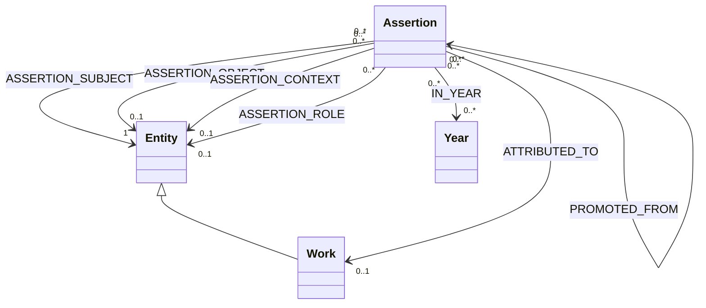

### 1.2 Evidence and review

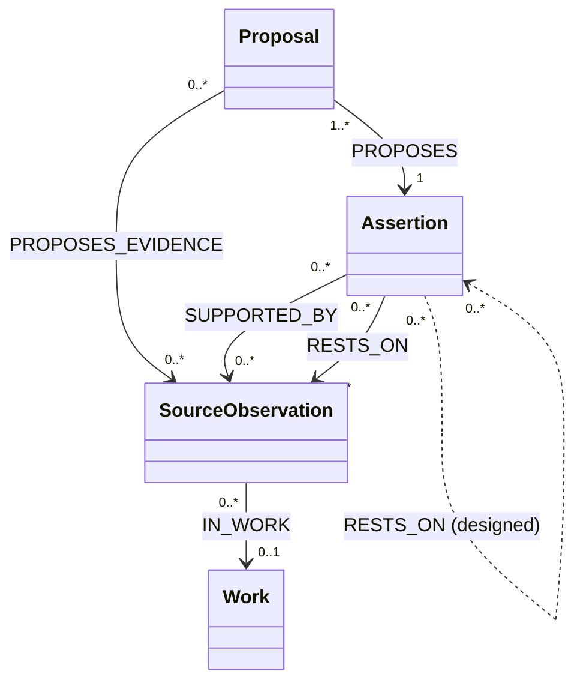

### 1.3 Identity, subjects, and headings

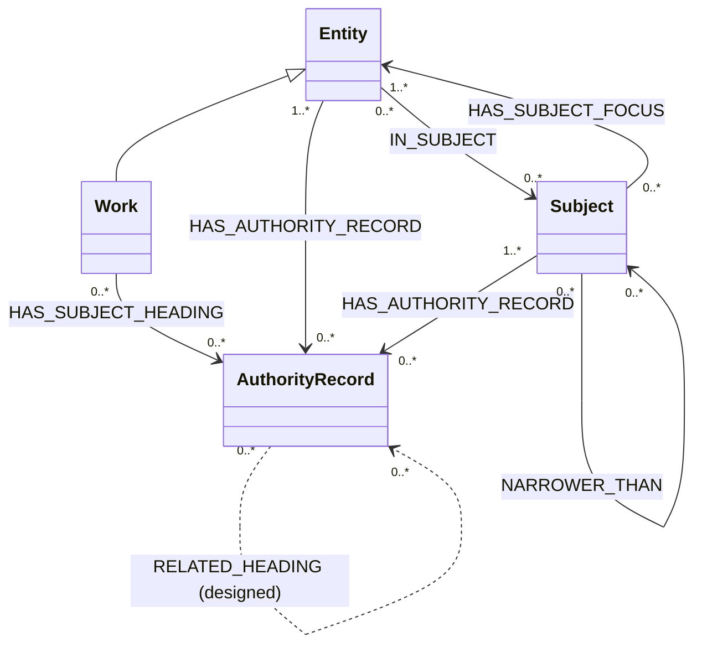

### 1.4 Commentary

An Annotation's `CONCERNS` targets, taken together, are `1..*`: every
Annotation concerns something. Today every target is an Entity; 32 §2.1
widens the targets to an Assertion, a Subject, a Proposal, or another
Annotation, so a note on a claim comments on it without becoming one.

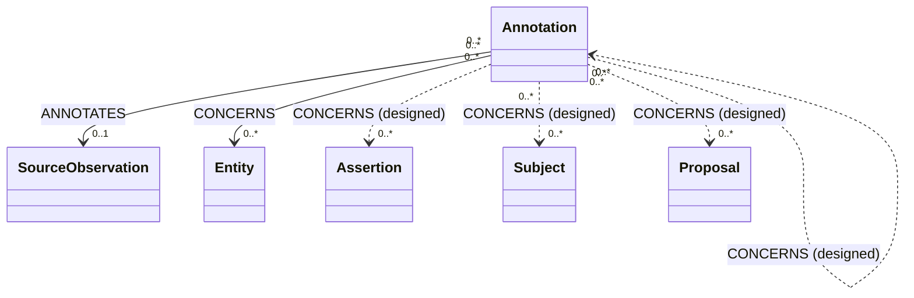

### 1.5 Backbones

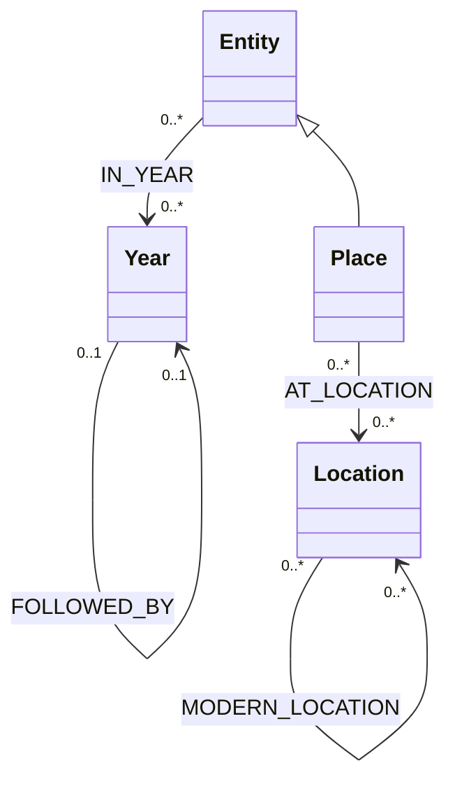

### 1.6 Fact layer (derived, §4.1)

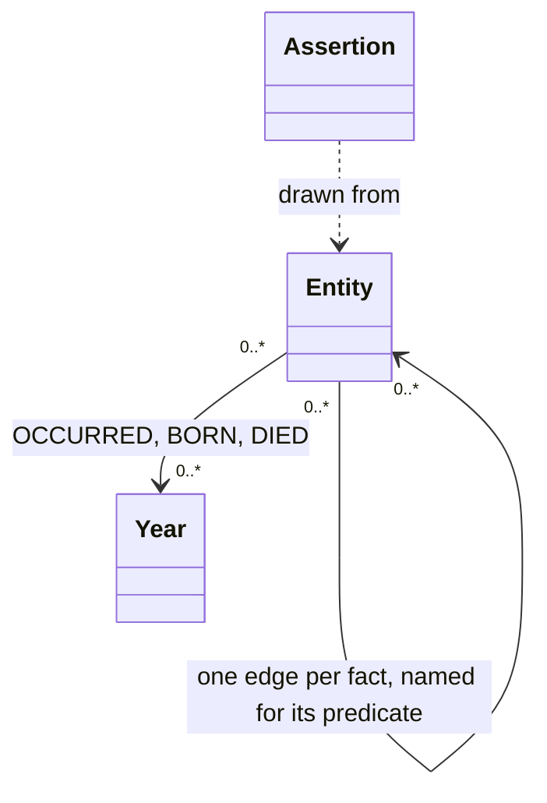

## 2. Classes and properties

Each table lists every property the live graph holds on that label, plus the
properties the operations or the designs write that no node yet carries
(marked *designed*). **Mult.** is the property's multiplicity: `[1]`
required, `[0..1]` optional. **Live** is how many nodes carry it on
2026-11-18: a dated snapshot, not kept current. For today's numbers run
`python -m GraphRevised.validate_ontology` or the Cypher in §7. The meaning of
each property is in [36](36-DATA-DICTIONARY.md) §2.

### 2.1 Entity

A real-world or analytical thing, or one of our own units of a reading (§3.1).
Unique: `id`. 848 Entities.

| Property | Type | Mult. | Live | Notes |
|---|---|---|---|---|
| id | String | [1] | 848 | `chr:entity:…`; unique |
| subtype label | Entity subtype | [1] | 848 | exactly one approved label in addition to `Entity`; fixed once set |
| label | String | [1] | 848 | reader-facing caption |
| shortLabel | String | [0..1] | 742 | compact caption |
| status | EntityStatus | [1] | 848 | |
| description | String | [0..1] | 301 | locally adopted display text |
| alternativeNames | List<String> | [0..1] | 3 | |
| sourceNote | String | [0..1] | 2 | |
| decidedAt, decidedBy, decisionBasis | String | [0..1] | 13 | the curator's decision on a proposed Entity |
| previousKind, kindChangedAt, kindChangedBy, kindChangeBasis | String | [0..1] | 3 | a corrected subtype (doc 34) |
| mergedIds, mergeLog | List<String> | [0..1] | 3 | Entities merged into this one |
| **Work only** | | | | |
| form | WorkForm | [0..1] | 28 | a creative form makes claims attributed to the Work imaginative |
| standing, standingSetAt, standingSetBy, standingBasis | String | [0..1] | 67 | D-148: primary, secondary, tertiary; every Work has one |
| standingConfirmedAt, standingConfirmedBy | String | [0..1] | 56 | |
| **Type only** | | | | |
| typeCategory, typeCategorySetAt, typeCategorySetBy, typeCategoryBasis | String | [0..1] | 41 | D-039, registry v15/v16; every Type has one |
| **Event only** | | | | |
| eventType | String | [0..1] | 1 | |
| **Derived by the fact layer** (D-144) | | | | |
| when, where, partOf | String | [0..1] | 120 / 53 / 492 | display summaries: one answer with who says it, rebuilt by `export.fact_layer` |
| history | String | [0..1] | 26 | Positions only (44): who held and rejected it, in words |

### 2.2 Subject

A body of knowledge or inquiry; since [28](28-SUBJECT-BUCKETS.md), also a
bucket. Created intentionally, never a shadow of an Entity. Unique: `id`.

| Property | Type | Mult. | Live | Notes |
|---|---|---|---|---|
| id | String | [1] | 20 | `chr:subject:…` |
| label | String | [1] | 20 | |
| shortLabel | String | [0..1] | 1 | |
| status | SubjectStatus | [1] | 20 | |

### 2.3 Assertion

A local claim. Predicate, endpoints, qualifiers, and mode are fixed at
creation; a change to any is a different Assertion. The id is
content-addressed (02 §6.1): subject, predicate, object, and a digest of mode,
attribution, context, role, time, quantity, and reception. Unique: `id`.

| Property | Type | Mult. | Live | Notes |
|---|---|---|---|---|
| id | String | [1] | 2803 | machine identifier, never a caption |
| predicate | String | [1] | 2803 | a registry predicate (§5) |
| label | String | [1] | 2803 | generated from subject, predicate phrase, object |
| shortLabel | String | [0..1] | 2803 | |
| status | AssertionStatus | [1] | 2803 | created `proposed` |
| category | ClaimCategory | [1] | 2803 | from the predicate; `imaginative` when attributed to a creative Work |
| mode | ClaimMode | [0..1] | 2043 | part of identity; 760 claims have none (§8 item 1) |
| assertedBy | String | [1] | 2803 | the agent or person that drafted it |
| acceptedAt | String | [0..1] | 573 | |
| contextBasis | String | [0..1] | 80 | why the context Event was attached |
| **Corroboration** (D-148, [42](42-CORROBORATION-AND-CLAIM-KINDS.md)) | | | | |
| basis, basisSetAt, basisSetBy | String | [0..1] | 1180 | what an attributed claim of a modern or reference Work is doing: reports, reconstructs, unknown |
| **Time qualifier** ([22](22-CLAIM-QUALIFIERS.md) §6) | | | | |
| timeSourceExpression | String | [0..1] | 378 | the source's own wording |
| timeEdtf | String | [0..1] | 242 | normalized EDTF value |
| timePrecision | TimePrecision | [0..1] | 242 | |
| timeCalendar | String | [0..1] | 242 | |
| timeMode | TimeMode | [0..1] | 227 | |
| timeApproximate, timeUncertain | Boolean | [0..1] | 242 | |
| timeNormalizationBasis | String | [0..1] | 242 | |
| startEarliestJdn, startLatestJdn | Integer | [0..1] | 229 | Julian Day window of the start |
| endEarliestJdn, endLatestJdn | Integer | [0..1] | 240 | Julian Day window of the end |
| timeRelativeOffset | String | [0..1] | 0 | *designed*: offset within a context Event (registry v10) |
| **Quantity qualifier** (registry v9, v16) | | | | |
| quantityMinimum, quantityMaximum, quantityTypical | Number | [0..1] | 0 | *designed*: `partOf`, `electedBy`, `hadStrength`, `captured` |
| quantitySourceExpression, quantityPrecision | String | [0..1] | 0 | *designed*; precision exact, approximate, round, rhetorical |
| **Historiography qualifiers** (registry v17, [44](44-HISTORIOGRAPHY-AND-DEBATES.md)) | | | | |
| reception | String | [0..1] | 4 | on `hadReception`; part of identity |
| stance | String | [0..1] | 0 | *designed*: on `holds`; not part of identity |
| **Lifecycle acts** | | | | |
| supersededFrom, supersededAt, supersededBy, supersedeBasis, supersedeReason | String | [0..1] | 362 | supersession; reason is a ReasonCode |
| reopenedAt, reopenedBy, reopenBasis | String | [0..1] | 0 | *designed*: reopen |
| retractedAt, retractedBy, retractBasis, retractReason | String | [0..1] | 0 | *designed*: retraction |

### 2.4 Proposal

A requested graph change; durable editorial history. Proposes exactly one
Assertion. Provenance fields are fixed at creation. Unique: `id`.

| Property | Type | Mult. | Live | Notes |
|---|---|---|---|---|
| id | String | [1] | 3164 | |
| operation | ProposalOperation | [1] | 3164 | |
| label | String | [1] | 3164 | the requested action in plain language |
| shortLabel | String | [0..1] | 3164 | |
| status | ProposalStatus | [1] | 3164 | created `submitted` |
| createdBy | String | [1] | 3164 | the Phase 2 Proposal's back-filled by migration 019 (§8 item 8) |
| rationale | String | [1] | 3164 | |
| draftSchemaVersion | String | [1] | 3164 | the Phase 2 Proposal's says it predates the draft schema |
| predicateRegistryVersion | String | [1] | 3164 | (as draftSchemaVersion) |
| provenanceBackfilledAt, provenanceBackfilledBy, provenanceBackfillBasis | String | [0..1] | 1 | marks a back-fill, so it is never read as written at creation |
| promptVersion | String | [0..1] | 2200 | agent-made Proposals |
| modelId | String | [0..1] | 2126 | agent-made Proposals |
| inquiryId | String | [0..1] | 2122 | the inquiry that produced it (the inquiry itself is a file, §7.3) |
| relevance | String | [0..1] | 2024 | why the evidence bears on the inquiry |
| ambiguities | List<String> | [0..1] | 3152 | |
| decidedAt, decidedBy, decisionBasis | String | [0..1] | 1177 | set once on a decision |
| decisionReason | ReasonCode | [0..1] | 449 | rejections |
| rejectedClaim | Boolean | [0..1] | 450 | the decision also rejected the claim |

### 2.5 SourceObservation

A preserved statement, passage, record, transcription, or image record. Source
facts are immutable; only display text and status change. Unique: `id`.

| observationKind | Live | What it is | Evidence? |
|---|---|---|---|
| *(unset)* | 464 | a Wikidata statement at one revision | yes |
| passage | 334 | a located span of a text edition (Gutenberg 128, LacusCurtius 113, Perseus 62, Wikipedia 31) | yes |
| record | 66 | a preserved record (coin types from CRRO 52, PeriodO 13, Library of Congress catalog 1) | yes |
| transcription | 115 | a quotation from a book in hand (curator 4) or a page of a licensed text read where it lies (`licensed-pdf` 111, D-156; the page never stored), `IN_WORK` its Work, private | yes; never across an elision (D-098) |
| image | 1 | the curator's image: its file's hash and path, what it depicts, who made it, its rights; the file never in Neo4j | **no** (D-097) |

| Property | Type | Mult. | Live | Notes |
|---|---|---|---|---|
| id | String | [1] | 980 | deterministic per kind |
| label | String | [1] | 980 | |
| shortLabel | String | [0..1] | 980 | |
| status | ObservationStatus | [1] | 980 | |
| sourceSystem | String | [1] | 980 | Wikidata, Perseus, Gutenberg, PeriodO, CRRO, Library of Congress catalog, licensed-pdf, curator, … |
| observationKind | ObservationKind | [0..1] | 516 | discriminator; unset on Wikidata statements |
| sourceRevision | Integer or String | [0..1] | 812 | Integer for Wikidata, String for text editions; absent on transcriptions and CRRO (§8 item 3) |
| retrievedAt | String | [1] | 980 | for the curator's kinds, when captured |
| contentHash | String | [1] | 980 | |
| rawPayloadUri | String | [0..1] | 868 | payload kept outside Neo4j; none for transcriptions of licensed pages |
| sourceUri | String | [0..1] | 402 | |
| visibility | Visibility | [0..1] | 116 | transcriptions and the image |
| capturedBy, capturedAt | String | [0..1] | 116 | |
| **Wikidata statements** | | | | |
| sourceEntityId | String | [0..1] | 530 | the statement's item |
| predicateExternalId | String | [0..1] | 464 | |
| predicateExternalLabel | String | [0..1] | 1 | |
| objectExternalId | String | [0..1] | 415 | |
| externalStatementId | String | [0..1] | 464 | |
| qualifierPropertyIds | List<String> | [0..1] | 463 | |
| statementQualifiers | String | [0..1] | 462 | serialized qualifiers |
| statementReferences | String | [0..1] | 161 | serialized references |
| statementStatedIn | List<String> | [0..1] | 161 | the works the references cite |
| statementTimeEdtf, statementTimeDisplay, statementTimeCalendar, statementTimeMode | String | [0..1] | 87 | the statement's time, normalized |
| statementTimeRenormalizedAt, …From, …Basis | String | [0..1] | 8 | |
| **Passages and transcriptions** | | | | |
| workTitle | String | [0..1] | 515 | |
| author | String | [0..1] | 399 | |
| translator | String | [0..1] | 159 | |
| editionCitation | String | [0..1] | 515 | |
| language | String | [0..1] | 515 | |
| rights | String | [0..1] | 516 | also on images |
| locator | String | [0..1] | 515 | a transcription's chapter joins its page ("Prologue, p. 3") |
| locatorType | String | [0..1] | 115 | transcriptions: `page` or a Kindle location |
| passageText | String | [0..1] | 515 | without editorial notes; a transcription keeps the curator's ellipses |
| editorialNotes | List<String> | [0..1] | 515 | kept apart from the text |
| footnotes | List<String> | [0..1] | 18 | Wikipedia passages (D-150) |
| passageHash | String | [0..1] | 515 | |
| **Images** (operation `upsert_image_observation`) | | | | |
| depicts | String | [0..1] | 1 | what it shows; a reconstruction says so |
| madeBy | String | [0..1] | 1 | |
| madeOn | String | [0..1] | 0 | from the photo's own date when not given |
| collection, accession | String | [0..1] | 1 / 0 | the museum, archive, or site, and its number there |

### 2.6 AuthorityRecord

An external record or identifier. It identifies the record; it does not
accept the record's data locally. External codes are reached only through
their AuthorityRecord, never inside a local id (02 §6.1). Unique: `id`;
unique: `(system, identifier)`.

| Property | Type | Mult. | Live | Notes |
|---|---|---|---|---|
| id | String | [1] | 550 | `chr:authority:<system>:<identifier>` |
| system | AuthoritySystem | [1] | 550 | |
| identifier | String | [1] | 550 | |
| label | String | [1] | 550 | read from the record |
| shortLabel | String | [0..1] | 550 | |
| description | String | [0..1] | 248 | the authority's wording, not a local description |
| retrievedAt | String | [0..1] | 465 | absent until the record is fetched: LC neighbour headings are stubs (D-155; 02 §1, 2026-11-18) |
| sourceRevision | Integer | [0..1] | 299 | Wikidata's revision; none for LC and OCLC records |
| sourceUri | String | [0..1] | 549 | the payload the record was read from: its own authority's, or Wikidata's for a crosswalk (D-168) |
| contentHash | String | [0..1] | 460 | (as retrievedAt) |
| rawPayloadUri | String | [0..1] | 460 | (as retrievedAt); the five fetch fields always describe one payload (D-168) |
| license | String | [0..1] | 1 | |
| formerId | String | [0..1] | 10 | before a system rename (migration 007) |
| mergedIds | List<String> | [0..1] | 1 | records merged into this one |

### 2.7 Annotation

Commentary, never a claim. Freely deletable. Unique: `id` (migration 003).

| kind | Live | Written by | What it is |
|---|---|---|---|
| passage-of-note | 378 | the passage reader | a passage worth reading for an entity, and why |
| entity-mention | 608 | the passage reader | the words that first name an entity, such as a depicted event |
| note | 3 | the vault sync ([capture/notes.py](capture/notes.py)) | the curator's note on a book; `ANNOTATES` its transcription |
| image-note | 1 | the vault sync | the curator's note on an image; `ANNOTATES` the image record |
| path | 0 | *designed* (32 §2.2) | a saved path: an ordered list of node and claim ids; asserts nothing |

| Property | Type | Mult. | Live | Notes |
|---|---|---|---|---|
| id | String | [1] | 990 | for notes, also in the note's frontmatter |
| kind | AnnotationKind | [1] | 990 | discriminator |
| noteType | NoteType | [0..1] | 988 | |
| label | String | [1] | 990 | what it is and where, never what it says |
| note | String | [0..1] | 985 | the content; an excerpt (no words of the curator's) has none |
| author | String | [1] | 990 | |
| visibility | Visibility | [1] | 990 | |
| status | AnnotationStatus | [1] | 990 | |
| createdAt | String | [1] | 990 | |
| decidedAt, decidedBy | String | [0..1] | 117 | endorsement or dismissal |
| title, body, modifiedAt, origin, filePath | String | [0..1] | 0 | *designed* (32 §2.1): the note's Markdown and where it came from |
| quotationStatus | QuotationStatus | [0..1] | 0 | *designed*: set by the curator, never by a model |
| generatedBy, pathIds | String; List of String | [0..1] | 0 | *designed*: saved paths |

### 2.8 Year

The temporal backbone, −2000 to 2025, no year zero. Unique: `year`.

| Property | Type | Mult. | Live | Notes |
|---|---|---|---|---|
| year | Integer | [1] | 4025 | canonical; unique |
| label | String | [1] | 4025 | "31 BCE" |
| iso8601_start, iso8601_end | String | [1] | 4025 | |
| temporal_backbone | Boolean | [1] | 4025 | |
| year_value | Integer | [1] | 4025 | legacy; equals `year`; new writes must not use it |
| created | DateTime | [1] | 4025 | legacy operational metadata |

### 2.9 Location

The gazetteer: Pleiades (42,399) and GeoNames (463,147), loaded 2026-10-14/15.
Unique: `id`; unique: `(system, identifier)`; point index on `location`.

| Property | Type | Mult. | Live | Notes |
|---|---|---|---|---|
| id | String | [1] | 505546 | |
| system | LocationSystem | [1] | 505546 | |
| identifier | String | [1] | 505546 | |
| dataset | String | [1] | 505546 | the dump, its date and hash |
| kind | String | [1] | 505546 | Pleiades place type or GeoNames feature code |
| label | String | [1] | 505546 | |
| location | Point | [0..1] | 497961 | absent for unlocated Pleiades places |
| names | List<String> | [0..1] | 27282 | Pleiades |
| nameAttestations | List<String> | [0..1] | 27282 | Pleiades |
| placeTypes | List<String> | [0..1] | 42398 | Pleiades |
| population | Integer | [0..1] | 146417 | GeoNames |

## 3. Entity subtypes (generalization)

The shared `Entity` label is specialized by exactly one approved Neo4j subtype
label. The subtype labels are complete and disjoint for the current ontology;
the compatibility word `kind` remains in registry/API vocabulary but is not a
stored Entity property. Some associations are restricted to one subtype (below);
the relationships between subtypes are in §3.2.

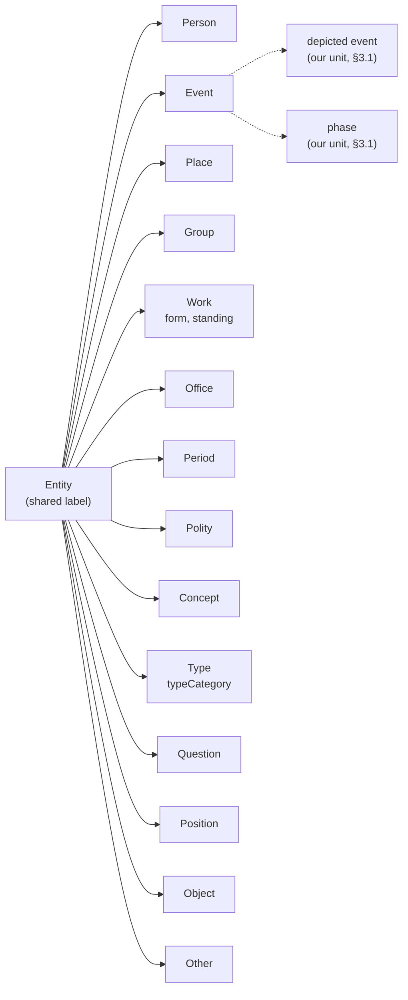

Every arrow from `Entity` is a subtype label, exactly one per node. The dashed
arrows are not labels: depicted events and phases are Events told apart by
their id (§3.1).

| Subtype | Live count | Holds |
|---|---:|---|
| Event | 485 | battles and wars; depicted events and phases |
| Person | 97 | |
| Work | 67 | sources and depictions; carries `form` and `standing` |
| Group | 45 | fleets, armies, legions, factions |
| Type | 41 | roles, unit types, ship types, naval fittings, organizational patterns, powers, statuses; carries `typeCategory` |
| Position | 40 | one answer to a Question, shared by the Works that hold it (44) |
| Place | 25 | the only subtype linked to Location |
| Question | 20 | a historical question scholars answer differently (44) |
| Office | 18 | positions and posts; the default role subtype |
| Concept | 3 | analytical ideas and frames |
| Period | 3 | |
| Polity | 3 | states |
| Object | 1 | a thing taken, dedicated, or destroyed (`involvedIn`, registry v14) |
| Other | 0 | |

Subtype restrictions that hold in the stored graph:

- `ATTRIBUTED_TO`, `IN_WORK`, and `HAS_SUBJECT_HEADING` concern a Work.
- `AT_LOCATION` starts at a Place.
- `ASSERTION_CONTEXT` targets the predicate's `contextKinds` (Event by default).
- `ASSERTION_ROLE` targets the predicate's `roleKinds` (Office by default; the
  one live role is a Type).
- `ASSERTION_SUBJECT` and `ASSERTION_OBJECT` follow the predicate's
  `subjectKinds` and `objectKinds` (§5).

### 3.1 Our own units: depicted events and phases

Two sorts of Event are units of a reading, not identities from an authority
(02 §1, "Our own units"). They are not kinds: they are Events told apart by
their id and label, drawn above as Event subtypes for clarity only.

| Unit | Id form | Live | Label | Its claims |
|---|---|---|---|---|
| Depicted event | `chr:entity:depicted:<work>:<slug>` | 460 | with its voice: "Antony's flight (Plutarch)" | attributed to that Work; the same action in two sources is two depicted events until linked by `depictsSameAs` (6 links) |
| Phase | `chr:entity:phase:<event>:<key>` | 11 (Battle of Actium, all provisional) | as ours: "The lines engage (Chrystallum)" | each `partOf` the event, asserted; each depicted event `partOf` one phase at most |

The phases' order is not in the graph: it is the curator's ordered spine in
`curation/phases.json` (D-091), never claims between phases.

### 3.2 Relationships between entity types

Entity types are related at three levels:

1. **The predicate registry** (§5) is the type-level model. Each predicate
   names the kinds it joins: `participatedIn` joins a Person, Group, or Polity
   to an Event. The file `proposals/predicates.v19.json` is its source, and
   since D-159 it is also drawn in the graph as `Predicate` and `EntityKind`
   nodes (§3.3), so the type-level model can be queried where the entities
   are. The guarded operations refuse a claim whose ends are the wrong kinds.
2. **Assertions** are the instances: each is one claim between two Entities,
   with its voices, evidence, and status. They are the source of truth.
3. **The fact layer** (§4.1) draws each live fact as a direct edge between the
   two Entities (`(:Person)-[:PARTICIPATED_IN]->(:Event)`), so the type-level
   relationships can be walked in one hop. It is derived from the Assertions.
   The graph type (§7.2) pins each fact edge whose predicate joins one kind to
   one kind (31 of the 44): the database refuses a `BORN_AT` edge that does
   not run from a Person to a Place.

The diagrams below draw the registry (v17) as relationships between subtypes,
one diagram per area. A solid arrow is a factual predicate, a dashed arrow an
interpretive one. Unary predicates have no object and are not drawn:
`occurred` (Event, Period, Polity), `born` and `died` (Person),
`hadStrength` (Group), `hadReception` (Position). `describedBy` (any kind to a
Work) and `distinctFrom` (any kind to any kind) are drawn once, in the last
diagram but one.

The same relationships can be queried in the graph (§3.3).

#### People

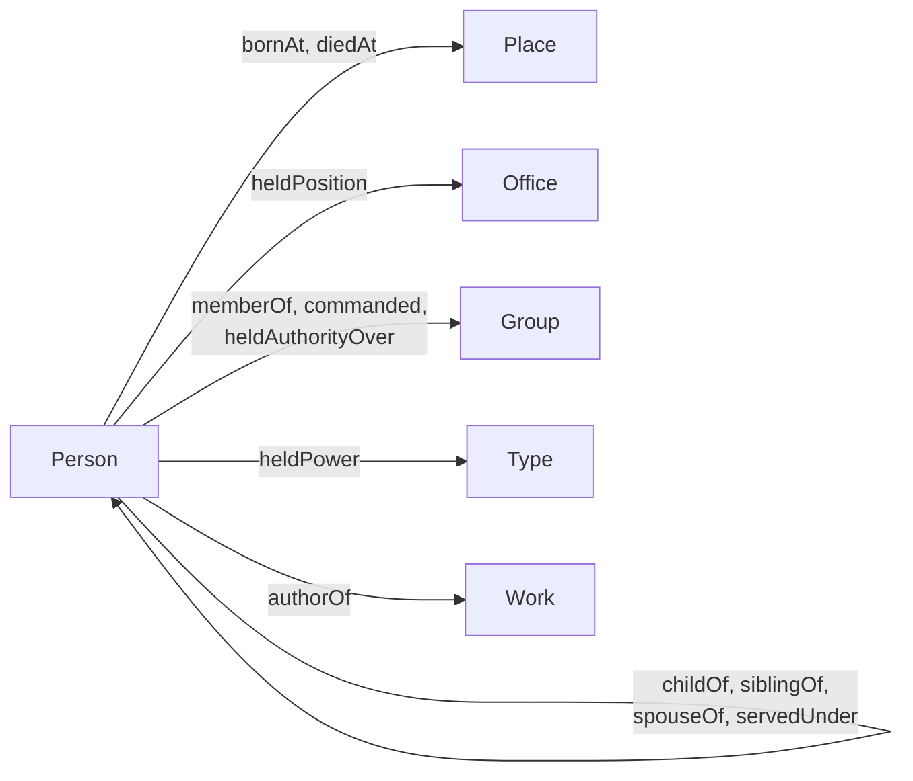

#### Events

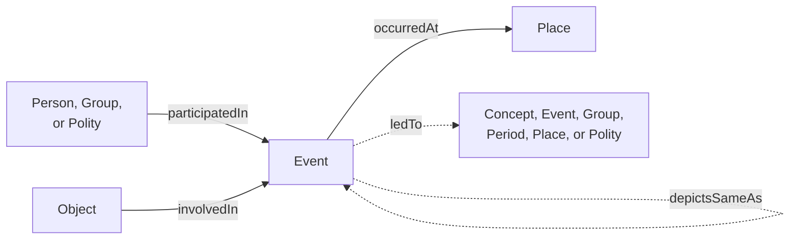

#### Forces, offices, and powers

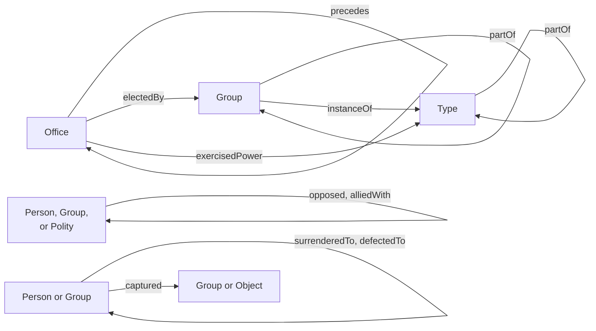

#### Periods, works, and concepts

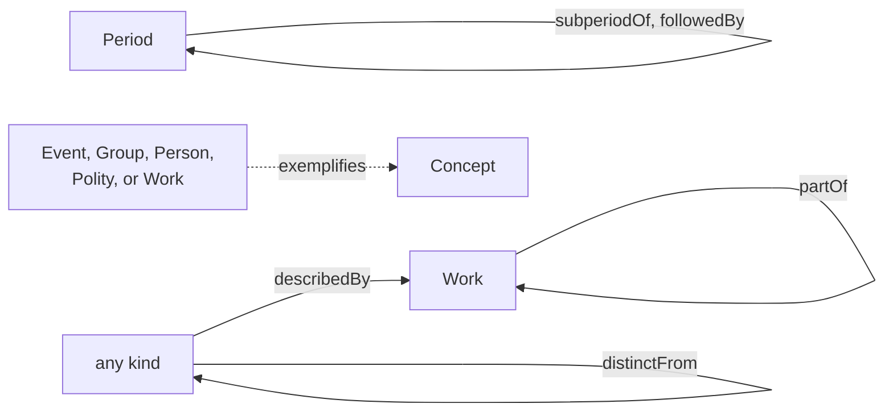

#### Historiography (44; every predicate interpretive)


### 3.3 The registry in the graph (D-159)

[proposals/registry_graph.py](proposals/registry_graph.py) draws the current
registry version into Neo4j. The file stays the source; the nodes are its
copy, rewritten on each sync and off the canvas like the backbones.

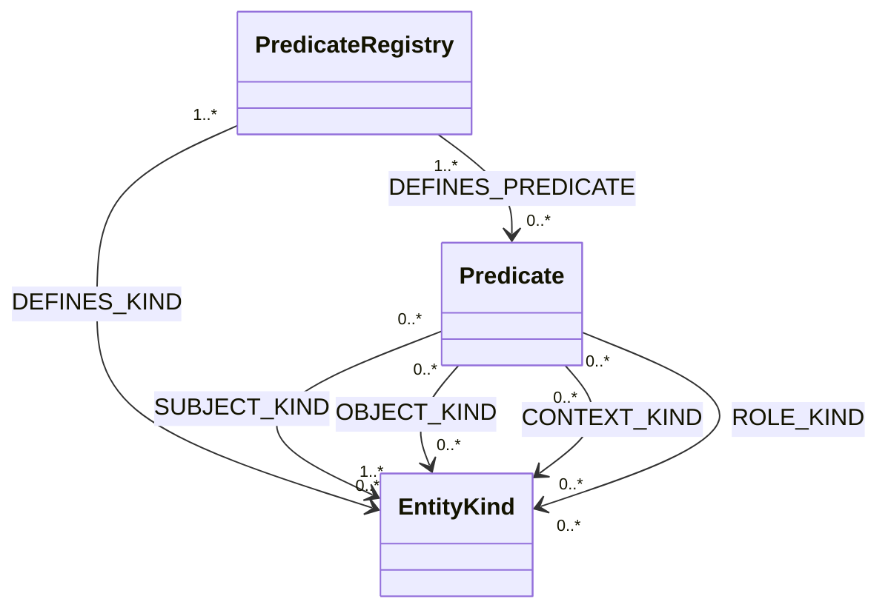

| Label | Live | Key | Holds |
|---|---:|---|---|
| PredicateRegistry | 1 | `id` `chr:registry:<version>`; `version` unique | one node per version loaded; the newest has `current: true`; `contentHash` and `sourcePath` of the file, `roleKind` (the default role kind), `loadedAt` |
| Predicate | 44 | `id` `chr:predicate:<name>`; `name` unique | `name` is `Assertion.predicate`; `label` the display phrase; `definition`, `category`, `modes`, `symmetric`, `once`, `unary`; the qualifier rules `context`, `role`, `time`, `quantity`, `stance`, `reception` (none, optional, required, withRole); `kindPairs` ("Event -> Event"), `wikidata` ("P361 forward"); `factLayerType` (its fact-layer edge); `registryVersion`, `status` (current, retired), `retiredIn` |
| EntityKind | 14 | `id` `chr:kind:<name>`; `name` unique | `name` is the Neo4j subtype label; `status`, `registryVersion`, `retiredIn` |

`OBJECT_KIND` is absent on a unary predicate; `CONTEXT_KIND` and `ROLE_KIND`
are drawn only when the predicate allows that qualifier (175 kind links in
v17). A predicate or kind the current version drops is marked retired, never
deleted. A `partOf` claim's ends must also be one of its `kindPairs`.

Two queries it answers:

```cypher
// What may a Person claim, and of what?
MATCH (:EntityKind {name: "Person"})<-[:SUBJECT_KIND]-(p:Predicate {status: "current"})
OPTIONAL MATCH (p)-[:OBJECT_KIND]->(o:EntityKind)
RETURN p.name, p.label, collect(o.name) AS objects

// Which predicates, and how many live claims, could join these two entities?
MATCH (a:Entity {id: $a}), (b:Entity {id: $b})
MATCH (p:Predicate)-[:SUBJECT_KIND]->(sk:EntityKind), (p)-[:OBJECT_KIND]->(ok:EntityKind)
WHERE sk.name IN labels(a) AND ok.name IN labels(b)
OPTIONAL MATCH (c:Assertion {predicate: p.name})-[:ASSERTION_SUBJECT]->(a),
               (c)-[:ASSERTION_OBJECT]->(b)
RETURN p.name, count(c) AS claims
```

Nothing joins an Assertion to its Predicate node: `Assertion.predicate`
equals `Predicate.name`, an index seek.

## 4. Associations

**Mult. (src → tgt)** reads: how many sources per target node → how many
targets per source node. **Observed** gives the live count and the largest
fan-out seen (out = per source node, in = per target node).

| Relationship | From → To | Mult. (src → tgt) | Properties | Live | Observed max out / in |
|---|---|---|---|---|---|
| ASSERTION_SUBJECT | Assertion → Entity | 0..* → 1 | | 2803 | 1 / 264 |
| ASSERTION_OBJECT | Assertion → Entity | 0..* → 0..1 | | 2551 | 1 / 266 |
| ASSERTION_CONTEXT | Assertion → Entity | 0..* → 0..1 | | 80 | 1 / 80 |
| ASSERTION_ROLE | Assertion → Entity | 0..* → 0..1 | | 1 | 1 / 1 |
| ATTRIBUTED_TO | Assertion → Entity (Work) | 0..* → 0..1 | | 1953 | 1 / 353 |
| IN_YEAR | Assertion → Year | 0..* → 0..* | as [0..1] | 736 | 103 / 42 |
| SUPERSEDED_BY | Assertion → Assertion | 0..* → 0..* | | 362 | 1 / 1 |
| PROMOTED_FROM | Assertion → Assertion | 0..* → 0..* | | 8 | 2 / 1 |
| SUPPORTED_BY | Assertion → SourceObservation | 0..* → 0..* | quotation, qualifierQuotations, addedByProposal [0..1] | 766 | 7 / 10 |
| RESTS_ON | Assertion → SourceObservation (designed: also Assertion, Work) | 0..* → 0..* | status, createdBy, createdAt [1]; decisionBasis, citation, quotation [0..1] | 155 | 10 / 9 |
| PROPOSES | Proposal → Assertion | 1..* → 1 | | 3164 | 1 / 10 |
| PROPOSES_EVIDENCE | Proposal → SourceObservation | 0..* → 0..* | quotation, qualifierQuotations, migratedBy [0..1] | 3219 | 4 / 44 |
| IN_WORK | SourceObservation → Entity (Work) | 0..* → 0..1 | | 515 | 1 / 97 |
| HAS_AUTHORITY_RECORD | Entity → AuthorityRecord | 1..* → 0..* | role, relation, status [1]; statementRank, statementReferences, decidedAt, decidedBy, decisionBasis [0..1] | 318 | 13 / 2 |
| HAS_AUTHORITY_RECORD | Subject → AuthorityRecord | 1..* → 0..* | (as above) | 2 | 2 / 1 |
| HAS_SUBJECT_HEADING | Entity (Work) → AuthorityRecord | 0..* → 0..* | status, heading, observationId, createdBy, createdAt, decisionBasis | 5 | 5 / 1 |
| BROADER_HEADING | AuthorityRecord → AuthorityRecord | 0..* → 0..* | status, createdBy, createdAt, sourceIdentifier | 5 | 2 / 2 |
| RELATED_HEADING | AuthorityRecord → AuthorityRecord | 0..* → 0..* | (as BROADER_HEADING) | 0 | *designed* (D-155) |
| HAS_SUBJECT_FOCUS | Subject → Entity | 0..* → 1..* | | 2 | 1 / 1 |
| NARROWER_THAN | Subject → Subject | 0..* → 0..* | reason, approvedBy | 18 | 1 / 4 |
| IN_SUBJECT | Entity (Event) → Subject | 0..* → 0..* | status, reason, proposedBy, proposedAt, sourceAssertionId, decidedBy, decidedAt, decisionBasis | 12 | 1 / 12 |
| ANNOTATES | Annotation → SourceObservation | 0..* → 0..1 | quotation [1] | 979 | 1 / 13 |
| CONCERNS | Annotation → Entity | 0..* → 0..* (1..* over all targets) | | 1442 | 5 / 246 |
| CONCERNS | Annotation → Assertion, Subject, Proposal, Annotation | `0..* → 0..*` | | 0 | *designed* (32 §2.1) |
| IN_YEAR | Entity → Year | 0..* → 0..* | as [0..1] | 1 | 1 / 1 |
| FOLLOWED_BY | Year → Year | 0..1 → 0..1 | created [0..1] (legacy) | 4024 | 1 / 1 |
| AT_LOCATION | Entity (Place) → Location | 0..* → 0..* | status, basis [1] | 12 | 2 / 1 |
| WITHIN | Location → Location | 0..* → 0..* | tree, relation [1]; periods [0..1] | 466494 | 7 / 9039 |
| MODERN_LOCATION | Location → Location | 0..* → 0..* | how [1]; viaId, viaLabel, distanceKm [0..1] | 34673 | 5 / 327 |

Multiplicity notes:

- **ASSERTION_SUBJECT [1]**: every Assertion has exactly one subject
  (confirmed live). Both ends of a claim are Entities (02 §2, narrowed
  2026-11-18 from Entity or Subject, and Entity, Subject, or AuthorityRecord;
  no claim had used the wider ends). The graph type enforces it.
- **ASSERTION_OBJECT [0..1]**: unary predicates (`occurred`, `born`, `died`,
  `hadReception`, `hadStrength`) have none; every other predicate has one. No
  unary claim carries an object.
- **ATTRIBUTED_TO [0..1]**: required when `mode = attributed` (all 1,953
  attributed claims have one), absent when `asserted`.
- **PROPOSES 1..* → 1**: every Proposal proposes exactly one Assertion, and
  every Assertion has at least one Proposal (its `create`, then any
  `addEvidence`).
- **PROPOSES_EVIDENCE 0..***: most Proposals carry one evidence item; the 11
  phase Proposals carry up to four passages each; three `create` Proposals
  carry none.
- **SUPPORTED_BY** is written only when a Proposal is accepted, from that
  Proposal's pending evidence. Neither it nor `PROPOSES_EVIDENCE` targets an
  `image` observation (confirmed live).
- **RESTS_ON** (D-148, D-150) joins a modern or reference claim whose `basis`
  is `reports` to the ancient passage it retells; attestation counts the
  ancient line only when the target is text we hold. Every live link targets a
  passage; 36 §3 also allows an Assertion or a Work.
- **IN_YEAR from Assertion** is a projection derived from the time qualifier
  and rebuildable; `as` says which part of the span the Year is (`start`,
  `end`, `during`, `earliest`, `latest`). The one **IN_YEAR from Entity** is
  the Phase 2 *Battle of Actium → 31 BCE* link, due to be replaced by a
  sourced claim; it has no `as`.
- **HAS_AUTHORITY_RECORD**: an AuthorityRecord is normally held by one node;
  one LCSH record is shared by an Entity and a Subject, as
  [28](28-SUBJECT-BUCKETS.md) §4 intends. No AuthorityRecord is orphaned: the
  ones no node holds are reached by `HAS_SUBJECT_HEADING` or `BROADER_HEADING`.
- **IN_SUBJECT** is topical placement in a Subject section, resting on the
  claim its `sourceAssertionId` names; it never implies `partOf` (02 §2).
- **SUPERSEDED_BY 0..***: a superseded Assertion may be replaced by several
  more precise ones; all 362 live cases have one.
- **ANNOTATES [0..1]**: a passage-of-note annotates its passage, a note its
  transcription, an image-note its image; 11 entity-mention Annotations have
  none. The image note's link has no `quotation` (an image has no words).

### 4.1 The fact layer (derived)

[export/fact_layer.py](export/fact_layer.py) draws every live fact as a direct
edge named after its predicate in upper snake case (`occurredAt` →
`OCCURRED_AT`; `followedBy` → `SUCCEEDED_BY`, so it never shares the Year
chain's `FOLLOWED_BY`). Every edge carries `derived: "fact-layer"`; the layer
is wiped and redrawn from the Assertions after reviews, never edited by hand
(D-144). Properties ([36](36-DATA-DICTIONARY.md) §3): `predicate`, `status`,
`mode`, `category`, `attestation`, `sentence`, `accordingTo`, `assertions`,
and `when` and `role` where the fact has them.

| Shape | Live | Types |
|---|---:|---|
| Entity → Entity | 2058 | PARTICIPATED_IN 672, PART_OF 645, HAPPENED_BEFORE 126, DESCRIBED_BY 98, TRIGGERED_BY 89, SIBLING_OF 60, CHILD_OF 58, OCCURRED_AT 54, ABOUT 42, ANSWERS 41, HELD_POSITION 27, HOLDS 26, INSTANCE_OF 25, SPOUSE_OF 19, COMMANDED 17, BORN_AT 10, DIED_AT 9, REJECTS 8, DEPICTS_SAME_AS 6, HELD_AUTHORITY_OVER 5, DISTINCT_FROM 4, ALLIED_WITH 3, AUTHOR_OF 3, OPPOSED 3, RESULTED_IN 3, EXEMPLIFIES 2, LED_TO 2, INVOLVED_IN 1 |
| Entity → Year | 189 | OCCURRED 143, BORN 28, DIED 18 (dated unary facts, with `as`) |

One edge stands for one fact, so it may group several Assertions (its
`assertions` list): the same claim in several voices. The entity's `when`,
`where`, and `partOf` summaries (§2.1) come from the same pass.

## 5. Assertion types: the predicate registry

The registry (`predicates-v19`) is the typing layer over `Assertion`: each
predicate fixes the kinds at both ends, the claim category, the allowed
modes, and the qualifier multiplicities. Qualifier multiplicity: **none** =
[0], **opt** = [0..1], **req** = [1], **withRole** = [1] when a role is given.
Modes: A = asserted, T = attributed.

| Predicate | Subject kinds → Object kinds | Cat. | Modes | Context | Role | Time | Live |
|---|---|---|---|---|---|---|---|
| participatedIn | Person, Group, Polity → Event | F | A T | none | opt | opt | 737 |
| partOf | Event, Group, Type, Work → Event, Group, Type, Work (paired) | F | A T | none | none | opt (+ quantity opt) | 649 |
| describedBy | any kind → Work | F | A T | none | none | none | 193 |
| occurred | Event, Period, Polity → (unary) | F | A T | opt | none | req | 146 |
| childOf | Person → Person | F | A T | none | none | none | 144 |
| siblingOf | Person → Person | F | A T | none | none | none | 131 |
| happenedBefore | Event → Event | F | A T | none | none | none | 126 |
| triggeredBy | Event → Event | F | A T | none | none | none | 89 |
| commanded | Person → Group | F | A T | opt | opt | withRole | 63 |
| occurredAt | Event → Place | F | A T | none | none | none | 62 |
| heldPosition | Person → Office | F | A T | none | none | req | 62 |
| born | Person → (unary) | F | A T | none | none | req | 62 |
| spouseOf | Person → Person | F | A T | none | none | req | 57 |
| about | Question → Event, Group, Period, Person, Polity | I | A T | none | none | none | 43 |
| answers | Position → Question | I | A T | none | none | none | 41 |
| died | Person → (unary) | F | A T | none | none | req | 40 |
| instanceOf | Group → Type | F | A T | none | none | opt | 26 |
| holds | Work → Position | I | T | none | none | opt (+ stance opt) | 26 |
| bornAt | Person → Place | F | A T | none | none | none | 20 |
| diedAt | Person → Place | F | A T | none | none | none | 18 |
| heldAuthorityOver | Person → Group | F | A T | opt | opt | req | 11 |
| opposed | Person, Group, Polity → Person, Group, Polity | F | A T | opt | none | req | 10 |
| distinctFrom | any kind → any kind | F | A T | none | none | none | 8 |
| rejects | Work → Position | I | T | none | none | opt | 8 |
| exemplifies | Event, Group, Person, Polity, Work → Concept | I | T | none | none | none | 6 |
| depictsSameAs | Event → Event | I | A | none | none | none | 6 |
| ledTo | Event → Concept, Event, Group, Period, Place, Polity | I | T | none | none | none | 5 |
| hadReception | Position → (unary) | I | T | none | none | req (+ reception req) | 4 |
| authorOf | Person → Work | F | A T | none | none | opt | 3 |
| resultedIn | Event → Event | F | A T | none | none | none | 3 |
| alliedWith | Person, Group, Polity → Person, Group, Polity | F | A T | none | none | req | 3 |
| involvedIn | Object → Event | F | A T | none | req | opt | 1 |
| subperiodOf | Period → Period | F | A T | none | none | none | 0 |
| followedBy | Period → Period | F | A T | none | none | none | 0 |
| precedes | Office → Office | F | A T | none | none | req | 0 |
| electedBy | Office → Group | F | A T | none | none | req (+ quantity opt) | 0 |
| exercisedPower | Office → Type | F | A T | none | none | req | 0 |
| heldPower | Person → Type | F | A T | opt | opt | req | 0 |
| servedUnder | Person → Person | F | A T | opt | opt | req | 0 |
| memberOf | Person → Group | F | A T | none | opt | req | 0 |
| hadStrength | Group → (unary) | F | A T | opt | opt | req (+ quantity req) | 0 |
| subtypeOf | Type → Type (v18; the authority's hierarchy) | F | T | none | none | none | 12 |
| madeOf | Object, Type → Type (v18) | F | A T | none | none | opt | 3 |
| struckIn | Work (coinage) → Type (v18) | F | A T | none | none | opt | 5 |
| madeFrom | Type → Type (v18) | F | A T | none | none | opt | 0 |
| producedAt | Type → Place (v18) | F | A T | none | none | opt | 0 |
| captured | Group, Person → Group, Object | F | A T | opt | none | req (+ quantity opt) | 0 |
| surrenderedTo | Group, Person → Group, Person | F | A T | opt | none | req | 0 |
| defectedTo | Group, Person → Group, Person | F | A T | opt | none | req | 0 |

The qualifiers map onto the model: **context** is `ASSERTION_CONTEXT`,
**role** is `ASSERTION_ROLE`, **time** is the `time*` and `*Jdn` properties
with their derived `IN_YEAR` links, **quantity** is the `quantity*`
properties, **stance** and **reception** are the properties of those names.
Category: F = factual, I = interpretive; any claim attributed to a Work of a
creative form becomes `imaginative`, derived, never chosen. The historiography
predicates (`about`, `answers`, `holds`, `rejects`, `hadReception`) are drafted
only through a reading's historiography section (D-156, rule 18).

Of the 649 `partOf` claims, 455 place the battle's phases: 11 phases `partOf`
the Battle of Actium (accepted) and 444 depicted events `partOf` a phase (443
proposed, 1 accepted).

## 6. Enumerations

| Enumeration | Values | Live |
|---|---|---|
| EntityKind | Person, Event, Place, Group, Object, Work, Period, Office, Concept, Polity, Type, Question, Position, Other | 13 in use, all but Other |
| EntityStatus | proposed, provisional, resolved, deprecated | proposed 746, provisional 99, deprecated 2, resolved 1 |
| SubjectStatus | candidate, provisional, validated, deprecated, merged | candidate 19, provisional 1 |
| AssertionStatus | proposed, accepted, rejected, contested (reserved, E8), superseded | proposed 1865, accepted 573, superseded 362, rejected 3 |
| ClaimCategory | factual, interpretive, imaginative | 2645 / 139 / 19 |
| ClaimMode | asserted, attributed | 90 / 1953 (760 unset) |
| ClaimBasis (D-148) | reports, reconstructs, unknown | reports 23, unknown 1157 |
| Stance (registry v17) | originates, adopts, modifies | *designed* |
| Reception (registry v17) | dominant, contested, minority, abandoned | dominant 4 |
| ProposalOperation | create, addEvidence | 2803 / 361 |
| ProposalStatus | submitted, validating, accepted, rejected, deferred | submitted 1987, accepted 720, rejected 457 |
| ReasonCode | false, unsupported, malformed, underspecified, superseded-by-model | superseded-by-model 431, unsupported 15, malformed 2, underspecified 1 |
| ObservationKind | passage, record, transcription, image (Wikidata statements: unset) | 334 / 66 / 115 / 1 |
| ObservationStatus | observed, superseded | observed 980 |
| AnnotationKind | passage-of-note, entity-mention, note, image-note; designed: path | 378 / 608 / 3 / 1 |
| NoteType | readers: interpretation, motive, characterization, anecdote, detail, atmosphere, speech, omen; notes: observation, question, hypothesis, interpretation, excerpt, outline, argument | detail 676, interpretation 122, motive 90, characterization 47, speech 16, omen 14, anecdote 13, atmosphere 7, excerpt 3 |
| AnnotationStatus | flagged, endorsed, dismissed; notes (32 §2.1): draft, active, endorsed, archived | flagged 873, endorsed 117 |
| Visibility | private, team, public (open, 32 §3 item 1: `team` or `shared`) | Annotations 917 / 73 / 0; SourceObservations private 116 |
| QuotationStatus | private-copy, public-domain, licensed, permission, review-required | *designed* |
| TimePrecision | year, month, day (and coarser) | 212 / 6 / 24 |
| TimeMode | during, within | 208 / 19 |
| WorkForm | history, biography, chronicle, letters, speech, inscription, commentary, reference, dataset, coinage; creative: poem, play, novel, short story, film, television series, painting, sculpture, opera, song, video game | history 10, reference 5, poem 4, biography 3, dataset 3, coinage 2, inscription 1 |
| Standing (D-148) | primary, secondary, tertiary | tertiary 40, primary 17, secondary 10 |
| TypeCategory (registry v15, v16) | role, unit type, organizational pattern, power, status, ship type, naval fitting | role 26, ship type 7, unit type 4, naval fitting 3, status 1 |
| AuthoritySystem | Wikidata, LCSH, LCNAF, FAST, VIAF, Getty AAT, Nomisma, GND, DPRR, LCCN, GeoNames, Pleiades, TGN, Trismegistos, GBIF (decided, D-160; none yet); grouped into networks by the federation profile (02 §1, D-168) | Wikidata 225, LCSH 119, LCNAF 55, FAST 41, VIAF 28, Getty AAT 24, Nomisma 16, GND 15, DPRR 13, LCCN 6, GeoNames 2, Pleiades 2, TGN 2, Trismegistos 2 (2026-11-20) |
| AuthorityLink.role | entity_identity, crosswalk, subject_access (02 reserves faceted_subject_access, classification_correspondence, place_gazetteer, period_definition, object_type) | 224 / 94 / 2 |
| AuthorityLink.relation | closeMatch (exactMatch only with scope, type, and evidence) | closeMatch 320 |
| LocationSystem | Pleiades, GeoNames | 42399 / 463147 |
| WITHIN.tree / relation | modern: admin; ancient: part_of_physical, part_of_regional, part_of_admin, part_of_analytical, in_territory_of | |
| MODERN_LOCATION.how | nearest place, pleiades reference | 33164 / 1509 |
| IN_YEAR.as | start, end, during, earliest, latest | during 645, end 32, start 21, earliest 19, latest 19 (1 unset) |

## 7. Constraints, indexes, and lookup keys

### 7.1 Unique identifiers and lookup keys

| Constraint | Label | Property |
|---|---|---|
| entity_id_unique | Entity | id |
| subject_id_unique | Subject | id |
| assertion_id_unique | Assertion | id |
| proposal_id_unique | Proposal | id |
| source_observation_id_unique | SourceObservation | id |
| authority_record_id_unique | AuthorityRecord | id |
| authority_record_system_identifier_unique | AuthorityRecord | (system, identifier) |
| annotation_id_unique | Annotation | id |
| year_year_unique | Year | year |
| location_id_unique | Location | id |
| location_system_identifier_unique | Location | (system, identifier) |
| predicate_registry_id_unique, predicate_registry_version_unique | PredicateRegistry | id; version |
| predicate_id_unique, predicate_name_unique | Predicate | id; name |
| entity_kind_id_unique, entity_kind_name_unique | EntityKind | id; name |

Each constraint carries its range index. One extra index: `location_point`
(point, `Location.location`).

**Direct lookup** (02 §6.1, D-099): a read or write starts from a node found
by one of these keys, then walks a bounded number of relationships. The keys
are exactly the unique ones above. An external code (an LCNAF name, an LCCN,
a Wikidata item) is found as `AuthorityRecord(system, identifier)` and then
`HAS_AUTHORITY_RECORD` back to its Entity: two index seeks. No key is built
from a label, a description, or any other mutable property.

### 7.2 The model as a graph type (migration 018, applied 2026-11-18)

Neo4j 2026.09 Enterprise has Cypher 25 **graph types**, which can hold more of
this model in the database than the eleven unique ids.
[migrations/018_graph_type.py](migrations/018_graph_type.py) states the model
as one `ALTER CURRENT GRAPH TYPE SET` statement, built from tables in the
file. Its dry run (the default) counts the live items that break each rule;
on 2026-11-18, 241 rules were checked and none was broken, and the server
accepted the statement. Tried first on a throwaway database, it refused each
corrupting write and left the fact layer free. It was applied to the live
graph on 2026-11-18 (D-158, 02 §5), and extended the same day with the
fact-layer pins and the registry nodes (D-159), then with the Proposal
provenance and the claim endpoints (D-161): 619 rules, 694 constraints,
every index online. The fact layer was rebuilt under it unchanged (2,058 fact
edges, 189 Year edges).

What it enforces:

| Rule | From this document |
|---|---|
| Each of the 14 subtype labels implies `Entity` | §3 |
| Required properties present and typed, per label | the `[1]` rows of §2 |
| Optional properties typed where present (String, Integer, Boolean, Point, List<String>; `sourceRevision` Integer or String) | the Type column of §2 |
| 23 relationship types pinned to one source label and one target label, with their required properties: the ASSERTION_SUBJECT, ASSERTION_OBJECT, ASSERTION_CONTEXT, ASSERTION_ROLE, ATTRIBUTED_TO, SUPERSEDED_BY, PROMOTED_FROM, SUPPORTED_BY, PROPOSES, PROPOSES_ALIAS, PROPOSES_EVIDENCE, IN_WORK, HAS_SUBJECT_FOCUS, NARROWER_THAN, IN_SUBJECT, HAS_SUBJECT_HEADING, BROADER_HEADING, RELATED_HEADING, ANNOTATES, AT_LOCATION, WITHIN, MODERN_LOCATION, and FOLLOWED_BY rows | §4 |
| Required properties on HAS_AUTHORITY_RECORD and RESTS_ON, without pinning them | §4 |
| The registry nodes (D-159): PredicateRegistry, Predicate, and EntityKind with their required properties; DEFINES_PREDICATE, DEFINES_KIND, SUBJECT_KIND, OBJECT_KIND, CONTEXT_KIND, and ROLE_KIND pinned | §3.3 |
| **Fact-layer edges**: 31 types pinned to the one subject kind and one object kind their predicate allows (a dated unary fact to Year: BORN, DIED, HAD_STRENGTH, HAD_RECEPTION); the other 13 unpinned (PARTICIPATED_IN, PART_OF, OCCURRED, OPPOSED, ALLIED_WITH, ABOUT, DESCRIBED_BY, DISTINCT_FROM, EXEMPLIFIES, LED_TO, CAPTURED, SURRENDERED_TO, DEFECTED_TO); every fact edge requires `derived`, `predicate`, and `status`. Generated from the registry, so a registry bump is followed by a re-run | §3.2, §4.1 |
| The eleven unique constraints, restated under their own names (kept, not rebuilt), and six for the registry nodes (ids, Predicate and EntityKind names, the registry version) | §7.1 |

What it cannot enforce, and why:

- **Relationships with more than one source or target label in 02 §2**
  (CONCERNS, HAS_AUTHORITY_RECORD, IN_YEAR, RESTS_ON): a graph type pins one
  label at each end.
- **Exactly one subtype label per Entity**, multiplicities, the registry's
  kinds per predicate, status transitions, immutability, no image as
  evidence, no quotation across an elision: none is a graph-type rule.
- **Fact types with several kinds at an end** (above) are not pinned; a
  `partOf` edge is checked against its kind pairs by the guarded operations
  that made its claim.
- **Kept optional** because live data lacks them by design or from Phase 2:
  `ANNOTATES.quotation` (an image note has no words) and `IN_YEAR.as` (the
  Phase 2 Entity link).

Migration 018 is now the database schema: `SET` replaces the whole
graph type, so a new constraint is added to its tables and the migration
re-run, never created by hand. Indexes are not part of a graph type. After a
registry bump, run `python -m GraphRevised.proposals.registry_graph --apply`,
then 018 `--apply`, then the fact layer: a predicate whose kinds changed is
otherwise still pinned to the old ones.

The rules the database does not enforce today are held by the guarded
operations in [13](13-PHASE-3-DIRECT-OPERATIONS.cypher) and the validator: the
multiplicities in §4, kind restrictions in §3 and §5, status transitions,
immutability of source facts, of an Entity's subtype label, and of an
Assertion's predicate, endpoints, qualifiers, and mode; no image as evidence;
no quotation across a transcription's elision.

### 7.3 Not graph data

Kept as files, never as nodes ([31](31-ONE-COMMAND.md) §3.11, D-089): programs,
inquiries (`inquiries/`), plans, runs (`runs/`), orientation dossiers
(`dossiers/`), evidence packets, Chrystallum's accounts (`accounts/`), the
phases' order (`curation/phases.json`), queues, briefs, finds, source plans,
the curator's notes themselves (the vault's `obsidian_book_notes/`), and image
files. They name graph ids; the graph does not name them. The only trace in
the graph is a property that carries such an id, as `Proposal.inquiryId` does.

## 8. Observations from the profile

Points the curator may want to decide on; none is changed here.

1. **760 claims have no `mode`.** 453 are the phase placements written by
   `event-phases-agent` (02 and D-070 call the phases' `partOf` claims
   asserted), 276 are Wikidata statement proposals, and 31 are early reader,
   catalog, and curator claims. [22](22-CLAIM-QUALIFIERS.md) §10 says existing
   claims are `asserted`, but nothing back-filled the property. Because mode is
   part of a claim's identity digest, a back-fill would have to decide whether
   the ids change.
2. **The notes' statuses differ from 32 §2.1.** The note template's statuses
   are draft and active; the three notes and the image note are stored
   `flagged`, the readers' status.
3. **`SourceObservation.sourceRevision` has two types**: Integer (Wikidata
   revisions) and String (text edition hashes); it is absent on transcriptions
   and CRRO records. Migration 018 types it as either. The 111 licensed-page
   transcriptions and one curator transcription have no `rawPayloadUri`; for
   the licensed pages this is by design (D-156).
4. **`Year.year_value` and `Year.created`** remain legacy; the open question
   in [00](00-NEO4J-SCHEMA-SNAPSHOT.md) still stands.
5. **41 SourceObservations are unused**: 30 Wikidata statement observations,
   9 CRRO coin records, one passage, and one transcription, with no Proposal,
   support, `RESTS_ON`, or Annotation.
6. **23 Entities are isolated**, with no relationship at all: 17 Types, 5
   Works, and 1 Person (18 provisional, 5 proposed).
7. **Subject buckets:** the hierarchy is built (`NARROWER_THAN`, 18 links
   under two roots, *Roman Republic* and *History of the Battle of
   Philippi*), and `IN_SUBJECT` stores 12 topical placements in a Subject
   section. Computed membership remains unbuilt.
8. *Resolved 2026-11-18 (D-161).* The Phase 2 Proposal
   (`chr:proposal:accept-marcus-vipsanius-agrippa-participation-at-actium`)
   had no `createdBy`, `rationale`, `draftSchemaVersion`, or
   `predicateRegistryVersion`; migration 019 back-filled them, marked as a
   back-fill, and 018 now requires them. The five LC heading stubs keep no
   `retrievedAt`, `contentHash`, or `rawPayloadUri` until fetched: 02 makes
   those optional.
9. *Resolved 2026-11-18 (D-161).* 02 §2 allowed a Subject or AuthorityRecord
   at the ends of a claim, 36 Entity only. 02 now says Entity, and 018 pins
   ASSERTION_SUBJECT and ASSERTION_OBJECT to it.
