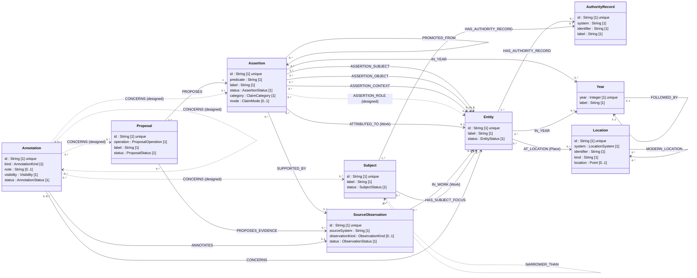
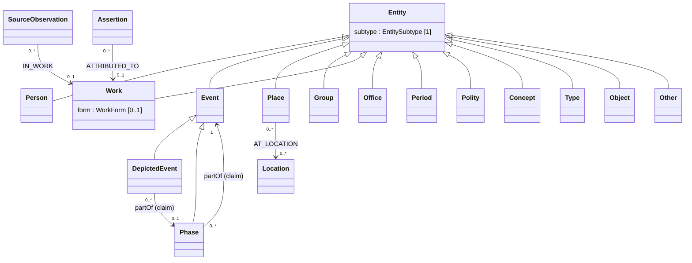

# 30 — Logical Model (UML)

**Date:** 2026-10-16; revised 2026-10-18 (phases, curator notes and images,
the LC catalogue, direct lookup).
**Status:** descriptive. It records the graph as built and as designed; it
changes no rule. Where this document and [02](02-GRAPH-MODEL.md) disagree, 02
governs and this document is out of date.
**Sources:** the live local database (`neo4j://127.0.0.1:7687`, database
`neo4j`, profiled read-only on 2026-10-18); [02](02-GRAPH-MODEL.md),
[22](22-CLAIM-QUALIFIERS.md), [23](23-NARRATIVE-AND-NOTES.md),
[27](27-GAZETTEER.md), [28](28-SUBJECT-BUCKETS.md),
[29](29-EVENT-CENTRED-INQUIRY.md), [31](31-ONE-COMMAND.md),
[32](32-RESEARCH-WORKSPACE.md), [33](33-DECISIONS.md); the operations file
[13](13-PHASE-3-DIRECT-OPERATIONS.cypher); [capture/notes.py](capture/notes.py);
the predicate registry `proposals/predicates.v11.json`.

## 0. Reading this model

- **Class = Neo4j label.** A domain entity uses the shared `Entity` label plus
  exactly one approved subtype label; infrastructure classes remain separate
  labels.
- **Association = relationship type**, drawn in its one stored direction.
- **Multiplicity** is written at each end, UML style: the number at the
  *target* end says how many targets one source node has; the number at the
  *source* end says how many sources one target node has. The multiplicity is
  the rule the design states; §4 sets it beside what the live graph shows.
- **Dashed** associations are designed but not yet in the graph.
- `Entity` is the shared label and `Person`, `Place`, `Event`, `Group`, `Work`,
  `Object`, `Period`, `Office`, `Concept`, `Polity`, `Type`, `Question`, `Position`, or `Other` is the
  subtype label. The subtype is the graph's discriminator; it is not stored as
  a `kind` property.
- `Assertion` is a **reified association**: a claim between Entities that
  carries its own identity, status, qualifiers, and evidence. The predicate
  registry (§5) types it.
- `SourceObservation` and `Annotation` also have a discriminator
  (`observationKind`, `kind`); their kinds carry different properties (§2.5,
  §2.7).

## 1. Overview diagram

An Annotation's `CONCERNS` targets, taken together, are `1..*`: every
Annotation concerns something. Today every target is an Entity; 32 §2.1
widens the targets to an Assertion, a Subject, a Proposal, or another
Annotation, so a note on a claim comments on it without becoming one.

The model has four layers, which the overview's comments group:

| Layer | Classes | Role |
|---|---|---|
| Knowledge | Entity, Subject, Assertion | what Chrystallum holds: things, inquiries and buckets, claims |
| Provenance and review | SourceObservation, AuthorityRecord, Proposal | what sources said, which external records identify things, how a claim entered |
| Commentary | Annotation | the readers' passages of note and the curator's notes; never a claim, never a hop in path tracing |
| Backbones | Year, Location | preloaded time and place scaffolds, off the canvas |

## 2. Classes and properties

Each table lists every property the live graph holds on that label, plus the
properties the operations or the designs write that no node yet carries
(marked *designed*). **Mult.** is the property's multiplicity: `[1]`
required, `[0..1]` optional. **Live** is how many nodes carry it on
2026-10-18: a dated snapshot, not kept current (on 2026-11-17 the graph held 824
entities, 20 Subjects, 2,762 claims). For today's numbers run
`python -m GraphRevised.validate_ontology` or the Cypher in §7; counts are no
longer kept in the headings.

### 2.1 Entity

A real-world or analytical thing, or one of our own units of a reading (§3.1).
Unique: `id`.

| Property | Type | Mult. | Live | Notes |
|---|---|---|---|---|
| id | String | [1] | 702 | `chr:entity:…`; unique |
| subtype label | Entity subtype | [1] | 702 | exactly one approved label in addition to `Entity`; fixed once set |
| label | String | [1] | 702 | reader-facing caption |
| shortLabel | String | [0..1] | 673 | compact caption |
| status | EntityStatus | [1] | 702 | |
| description | String | [0..1] | 222 | locally adopted display text |
| form | WorkForm | [0..1] | 11 | Works only; a creative form makes claims attributed to the Work imaginative |
| sourceNote | String | [0..1] | 2 | |
| decidedAt, decidedBy, decisionBasis | String | [0..1] | 11 | the curator's decision on a proposed Entity (the 11 phases) |

### 2.2 Subject

A body of knowledge or inquiry; since [28](28-SUBJECT-BUCKETS.md), also a
bucket. Created intentionally, never a shadow of an Entity. Unique: `id`.

| Property | Type | Mult. | Live | Notes |
|---|---|---|---|---|
| id | String | [1] | 1 | `chr:subject:…` |
| label | String | [1] | 1 | |
| shortLabel | String | [0..1] | 1 | |
| status | SubjectStatus | [1] | 1 | |

### 2.3 Assertion

A local claim. Predicate, endpoints, qualifiers, and mode are fixed at
creation; a change to any is a different Assertion. The id is
content-addressed (02 §6.1): subject, predicate, object, and a digest of mode,
attribution, context, role, time, and quantity. Unique: `id`.

| Property | Type | Mult. | Live | Notes |
|---|---|---|---|---|
| id | String | [1] | 2181 | machine identifier, never a caption |
| predicate | String | [1] | 2181 | a registry predicate (§5) |
| label | String | [1] | 2181 | generated from subject, predicate phrase, object |
| shortLabel | String | [0..1] | 2181 | |
| status | AssertionStatus | [1] | 2181 | created `proposed` |
| category | ClaimCategory | [1] | 2181 | from the predicate; `imaginative` when attributed to a creative Work |
| mode | ClaimMode | [0..1] | 1429 | part of identity; 752 claims have none (§8 item 1) |
| assertedBy | String | [1] | 2181 | the agent or person that drafted it |
| acceptedAt | String | [0..1] | 79 | |
| contextBasis | String | [0..1] | 69 | why the context Event was attached |
| **Time qualifier** ([22](22-CLAIM-QUALIFIERS.md) §6) | | | | |
| timeSourceExpression | String | [0..1] | 242 | the source's own wording |
| timeEdtf | String | [0..1] | 111 | normalized EDTF value |
| timePrecision | TimePrecision | [0..1] | 111 | |
| timeCalendar | String | [0..1] | 111 | |
| timeMode | TimeMode | [0..1] | 96 | |
| timeApproximate, timeUncertain | Boolean | [0..1] | 111 | |
| timeNormalizationBasis | String | [0..1] | 111 | |
| startEarliestJdn, startLatestJdn | Integer | [0..1] | 106 | Julian Day window of the start |
| endEarliestJdn, endLatestJdn | Integer | [0..1] | 110 | Julian Day window of the end |
| timeRelativeOffset | String | [0..1] | 0 | *designed*: offset within a context Event (registry v10) |
| **Quantity qualifier** (registry v9) | | | | |
| quantityMinimum, quantityMaximum, quantityTypical | Number | [0..1] | 0 | *designed*: `partOf`, `electedBy` |
| quantitySourceExpression | String | [0..1] | 0 | *designed* |
| **Lifecycle acts** | | | | |
| supersededFrom, supersededAt, supersededBy, supersedeBasis, supersedeReason | String | [0..1] | 8 | supersession; reason is a ReasonCode |
| reopenedAt, reopenedBy, reopenBasis | String | [0..1] | 0 | *designed*: reopen |
| retractedAt, retractedBy, retractBasis, retractReason | String | [0..1] | 0 | *designed*: retraction |

### 2.4 Proposal

A requested graph change; durable editorial history. Proposes exactly one
Assertion. Provenance fields are fixed at creation. Unique: `id`.

| Property | Type | Mult. | Live | Notes |
|---|---|---|---|---|
| id | String | [1] | 2392 | |
| operation | ProposalOperation | [1] | 2392 | |
| label | String | [1] | 2392 | the requested action in plain language |
| shortLabel | String | [0..1] | 2392 | |
| status | ProposalStatus | [1] | 2392 | created `submitted` |
| createdBy | String | [1] | 2391 | |
| rationale | String | [1] | 2391 | |
| draftSchemaVersion | String | [1] | 2391 | |
| predicateRegistryVersion | String | [1] | 2391 | |
| promptVersion | String | [0..1] | 1950 | agent-made Proposals |
| modelId | String | [0..1] | 1933 | agent-made Proposals |
| inquiryId | String | [0..1] | 1923 | the inquiry that produced it (the inquiry itself is a file, §7.1) |
| relevance | String | [0..1] | 1946 | why the evidence bears on the inquiry |
| ambiguities | List<String> | [0..1] | 2380 | |
| decidedAt, decidedBy, decisionBasis | String | [0..1] | 166 | set once on a decision |
| decisionReason | ReasonCode | [0..1] | 22 | rejections |
| rejectedClaim | Boolean | [0..1] | 23 | the decision also rejected the claim |

### 2.5 SourceObservation

A preserved statement, passage, record, transcription, or image record. Source
facts are immutable; only display text and status change. Unique: `id`.

| observationKind | Live | What it is | Evidence? |
|---|---|---|---|
| *(unset)* | 458 | a Wikidata statement at one revision | yes |
| passage | 334 | a located span of a text edition (Gutenberg 128, LacusCurtius 113, Perseus 62, Wikipedia 31) | yes |
| record | 14 | a preserved record (PeriodO 13, Library of Congress catalog 1) | yes |
| transcription | 4 | the curator's quotation from a book in hand, `IN_WORK` its Work, private | yes; never across an elision (D-098) |
| image | 1 | the curator's image: its file's hash and path, what it depicts, who made it, its rights; the file never in Neo4j | **no** (D-097) |

| Property | Type | Mult. | Live | Notes |
|---|---|---|---|---|
| id | String | [1] | 811 | deterministic per kind |
| label | String | [1] | 811 | |
| shortLabel | String | [0..1] | 811 | |
| status | ObservationStatus | [1] | 811 | |
| sourceSystem | String | [1] | 811 | Wikidata, Perseus, Gutenberg, PeriodO, Library of Congress catalog, curator, … |
| observationKind | ObservationKind | [0..1] | 353 | discriminator; unset on Wikidata statements |
| sourceRevision | String or Integer | [0..1] | 806 | absent on the curator's kinds; mixed types (§8) |
| retrievedAt | String | [1] | 811 | for the curator's kinds, when captured |
| contentHash | String | [1] | 811 | |
| rawPayloadUri | String | [0..1] | 810 | payload kept outside Neo4j |
| sourceUri | String | [0..1] | 350 | |
| visibility | Visibility | [0..1] | 5 | the curator's kinds |
| capturedBy, capturedAt | String | [0..1] | 5 | the curator's kinds |
| **Wikidata statements** | | | | |
| sourceEntityId | String | [0..1] | 472 | the statement's item |
| predicateExternalId | String | [0..1] | 458 | |
| predicateExternalLabel | String | [0..1] | 1 | |
| objectExternalId | String | [0..1] | 415 | |
| externalStatementId | String | [0..1] | 458 | |
| qualifierPropertyIds | List<String> | [0..1] | 457 | |
| statementQualifiers | String | [0..1] | 456 | serialized qualifiers |
| statementTimeEdtf, statementTimeDisplay, statementTimeCalendar, statementTimeMode | String | [0..1] | 81 | the statement's time, normalized |
| statementTimeRenormalizedAt, …From, …Basis | String | [0..1] | 8 | |
| **Passages and transcriptions** | | | | |
| workTitle | String | [0..1] | 352 | |
| author | String | [0..1] | 347 | |
| translator | String | [0..1] | 159 | |
| editionCitation | String | [0..1] | 352 | |
| language | String | [0..1] | 352 | |
| rights | String | [0..1] | 353 | also on images |
| locator | String | [0..1] | 352 | a transcription's chapter joins its page ("Prologue, p. 3") |
| locatorType | String | [0..1] | 4 | transcriptions: `page` or a Kindle location |
| passageText | String | [0..1] | 352 | without editorial notes; a transcription keeps the curator's ellipses |
| editorialNotes | List<String> | [0..1] | 352 | kept apart from the text |
| passageHash | String | [0..1] | 352 | |
| **Images** (operation `upsert_image_observation`) | | | | |
| depicts | String | [0..1] | 1 | what it shows; a reconstruction says so |
| madeBy | String | [0..1] | 1 | |
| madeOn | String | [0..1] | 0 | from the photo's own date when not given |
| collection, accession | String | [0..1] | 1 / 0 | the museum, archive, or site, and its number there |

### 2.6 AuthorityRecord

An external record or identifier. It identifies the record; it does not
accept the record's data locally. External codes are reached only through
their AuthorityRecord, never inside a local id (02 §6.1). Unique: `id`;
unique: `(system, identifier)`.

| Property | Type | Mult. | Live | Notes |
|---|---|---|---|---|
| id | String | [1] | 289 | `chr:authority:<system>:<identifier>` |
| system | AuthoritySystem | [1] | 289 | |
| identifier | String | [1] | 289 | |
| label | String | [1] | 289 | read from the record |
| shortLabel | String | [0..1] | 289 | |
| description | String | [0..1] | 190 | the authority's wording, not a local description |
| retrievedAt | String | [1] | 289 | |
| sourceRevision | Integer | [0..1] | 285 | |
| sourceUri | String | [0..1] | 288 | |
| contentHash | String | [1] | 289 | |
| rawPayloadUri | String | [1] | 289 | |
| license | String | [0..1] | 1 | |
| formerId | String | [0..1] | 10 | before a system rename (migration 007) |
| mergedIds | List<String> | [0..1] | 1 | records merged into this one |

### 2.7 Annotation

Commentary, never a claim. Freely deletable. Unique: `id` (migration 003).

| kind | Live | Written by | What it is |
|---|---|---|---|
| passage-of-note | 378 | the passage reader | a passage worth reading for an entity, and why |
| entity-mention | 544 | the passage reader | the words that first name an entity, such as a depicted event |
| note | 3 | the vault sync ([capture/notes.py](capture/notes.py)) | the curator's note on a book; `ANNOTATES` its transcription |
| image-note | 1 | the vault sync | the curator's note on an image; `ANNOTATES` the image record |
| path | 0 | *designed* (32 §2.2) | a saved path: an ordered list of node and claim ids; asserts nothing |

| Property | Type | Mult. | Live | Notes |
|---|---|---|---|---|
| id | String | [1] | 926 | for notes, also in the note's frontmatter |
| kind | AnnotationKind | [1] | 926 | discriminator |
| noteType | NoteType | [0..1] | 924 | |
| label | String | [1] | 926 | what it is and where, never what it says |
| note | String | [0..1] | 921 | the content; an excerpt (no words of the curator's) has none |
| author | String | [1] | 926 | |
| visibility | Visibility | [1] | 926 | |
| status | AnnotationStatus | [1] | 926 | |
| createdAt | String | [1] | 926 | |
| decidedAt, decidedBy | String | [0..1] | 117 | endorsement or dismissal |
| title, body, modifiedAt, origin, filePath | String | [0..1] | 0 | *designed* (32 §2.1): the note's Markdown and where it came from |
| quotationStatus | QuotationStatus | [0..1] | 0 | *designed*: set by the curator, never by a model |
| generatedBy, pathIds | String; List of String | [0..1] | 0 | *designed*: saved paths |

### 2.8 Year

The temporal backbone, −2000 to 2025, no year zero. Unique: `year`.

| Property | Type | Mult. | Live | Notes |
|---|---|---|---|---|
| year | Integer | [1] | 4025 | canonical; unique |
| label | String | [1] | 4025 | "31 BCE" |
| iso8601_start, iso8601_end | String | [1] | 4025 | |
| temporal_backbone | Boolean | [1] | 4025 | |
| year_value | Integer | [1] | 4025 | legacy; equals `year`; new writes must not use it |
| created | DateTime | [1] | 4025 | legacy operational metadata |

### 2.9 Location

The gazetteer: Pleiades (42,399) and GeoNames (463,147), loaded 2026-10-14/15.
Unique: `id`; unique: `(system, identifier)`; point index on `location`.

| Property | Type | Mult. | Live | Notes |
|---|---|---|---|---|
| id | String | [1] | 505546 | |
| system | LocationSystem | [1] | 505546 | |
| identifier | String | [1] | 505546 | |
| dataset | String | [1] | 505546 | the dump, its date and hash |
| kind | String | [1] | 505546 | Pleiades place type or GeoNames feature code |
| label | String | [1] | 505546 | |
| location | Point | [0..1] | 497961 | absent for unlocated Pleiades places |
| names | List<String> | [0..1] | 27282 | Pleiades |
| nameAttestations | List<String> | [0..1] | 27282 | Pleiades |
| placeTypes | List<String> | [0..1] | 42398 | Pleiades |
| population | Integer | [0..1] | 146417 | GeoNames |

## 3. Entity subtypes (generalization)

The shared `Entity` label is specialized by exactly one approved Neo4j subtype
label. The subtype labels are complete and disjoint for the current ontology;
the compatibility word `kind` remains in registry/API vocabulary but is not a
stored Entity property. Some associations are restricted to one subtype.

| Subtype | Live count | Holds |
|---|---:|---|
| Event | 483 | battles and wars; depicted events and phases |
| Person | 97 | |
| Work | 50 | sources and depictions; carries `form` |
| Place | 25 | the only subtype linked to Location |
| Group | 19 | fleets, armies, factions |
| Office | 19 | positions and posts; the default role subtype |
| Period | 3 | |
| Polity | 3 | states |
| Concept | 3 | analytical ideas and frames |
| Type | 0 | unit types, organizational patterns, roles, powers |
| Object, Other | 0 | |

Subtype restrictions that hold in the stored graph:

- `ATTRIBUTED_TO` and `IN_WORK` target a Work.
- `AT_LOCATION` starts at a Place.
- `ASSERTION_CONTEXT` targets the predicate's `contextKinds` (Event by default).
- `ASSERTION_ROLE` targets the predicate's `roleKinds` (Office by default).
- `ASSERTION_SUBJECT` and `ASSERTION_OBJECT` follow the predicate's
  `subjectKinds` and `objectKinds` (§5).

### 3.1 Our own units: depicted events and phases

Two sorts of Event are units of a reading, not identities from an authority
(02 §1, "Our own units"). They are not kinds: they are Events told apart by
their id and label, drawn above as Event subtypes for clarity only.

| Unit | Id form | Live | Label | Its claims |
|---|---|---|---|---|
| Depicted event | `chr:entity:depicted:<work>:<slug>` | 460 | with its voice: "Antony's flight (Plutarch)" | attributed to that Work; the same action in two sources is two depicted events until linked by `depictsSameAs` |
| Phase | `chr:entity:phase:<event>:<key>` | 11 (Battle of Actium, all provisional) | as ours: "The lines engage (Chrystallum)" | each `partOf` the event, asserted; each depicted event `partOf` one phase at most |

The phases' order is not in the graph: it is the curator's ordered spine in
`curation/phases.json` (D-091), never claims between phases.

## 4. Associations

**Mult. (src → tgt)** reads: how many sources per target node → how many
targets per source node. **Observed** gives the live count and the largest
fan-out seen (out = per source node, in = per target node).

| Relationship | From → To | Mult. (src → tgt) | Properties | Live | Observed max out / in |
|---|---|---|---|---|---|
| ASSERTION_SUBJECT | Assertion → Entity | 0..* → 1 | | 2181 | 1 / 218 |
| ASSERTION_OBJECT | Assertion → Entity | 0..* → 0..1 | | 1992 | 1 / 244 |
| ASSERTION_CONTEXT | Assertion → Entity | 0..* → 0..1 | | 69 | 1 / 69 |
| ASSERTION_ROLE | Assertion → Entity | 0..* → 0..1 | | 0 | *designed* |
| ATTRIBUTED_TO | Assertion → Entity (Work) | 0..* → 0..1 | | 1344 | 1 / 352 |
| IN_YEAR | Assertion → Year | 0..* → 0..* | as [0..1] | 425 | 103 / 13 |
| SUPERSEDED_BY | Assertion → Assertion | 0..* → 0..* | | 8 | 1 / 1 |
| PROMOTED_FROM | Assertion → Assertion | 0..* → 0..* | | 6 | 2 / 1 |
| SUPPORTED_BY | Assertion → SourceObservation | 0..* → 0..* | quotation, qualifierQuotations, addedByProposal [0..1] | 168 | 7 / 10 |
| PROPOSES | Proposal → Assertion | 1..* → 1 | | 2392 | 1 / 10 |
| PROPOSES_EVIDENCE | Proposal → SourceObservation | 0..* → 0..* | quotation, qualifierQuotations, migratedBy [0..1] | 2421 | 4 / 44 |
| IN_WORK | SourceObservation → Entity (Work) | 0..* → 0..1 | | 352 | 1 / 97 |
| HAS_AUTHORITY_RECORD | Entity → AuthorityRecord | 1..* → 0..* | role, relation, status [1]; statementRank, statementReferences [0..1] | 288 | 13 / 1 |
| HAS_AUTHORITY_RECORD | Subject → AuthorityRecord | 1..* → 0..* | (as above) | 2 | 2 / 1 |
| HAS_SUBJECT_FOCUS | Subject → Entity | 0..* → 1..* | | 1 | 1 / 1 |
| NARROWER_THAN | Subject → Subject | 0..* → 0..* | | 0 | Narrower to broader; several parents allowed |
| ANNOTATES | Annotation → SourceObservation | 0..* → 0..1 | quotation [1] | 915 | 1 / 12 |
| CONCERNS | Annotation → Entity | 0..* → 0..* (1..* over all targets) | | 1378 | 5 / 246 |
| CONCERNS | Annotation → Assertion, Subject, Proposal, Annotation | `0..* → 0..*` | | 0 | *designed* (32 §2.1) |
| IN_YEAR | Entity → Year | 0..* → 0..* | as [0..1] | 1 | 1 / 1 |
| FOLLOWED_BY | Year → Year | 0..1 → 0..1 | created [0..1] (legacy) | 4024 | 1 / 1 |
| AT_LOCATION | Entity (Place) → Location | 0..* → 0..* | status, basis [1] | 12 | 2 / 1 |
| WITHIN | Location → Location | 0..* → 0..* | tree, relation [1]; periods [0..1] | 466494 | 7 / 9039 |
| MODERN_LOCATION | Location → Location | 0..* → 0..* | how [1]; viaId, viaLabel, distanceKm [0..1] | 34673 | 5 / 327 |

Multiplicity notes:

- **ASSERTION_SUBJECT [1]**: every Assertion has exactly one subject
  (confirmed live). Doc 02 also allows a Subject as an assertion subject and a
  Subject or AuthorityRecord as an object; no live Assertion uses that.
- **ASSERTION_OBJECT [0..1]**: unary predicates (`occurred`, `born`, `died`)
  have none; every other predicate has one. No unary claim carries an object.
- **ATTRIBUTED_TO [0..1]**: required when `mode = attributed` (all 1,344
  attributed claims have one), absent when `asserted`.
- **PROPOSES 1..* → 1**: every Proposal proposes exactly one Assertion, and
  every Assertion has at least one Proposal (its `create`, then any
  `addEvidence`).
- **PROPOSES_EVIDENCE 0..***: most Proposals carry one evidence item; the 11
  phase Proposals carry up to four passages each (a phase is evidenced by the
  passages that depict its events); three `create` Proposals carry none.
- **SUPPORTED_BY** is written only when a Proposal is accepted, from that
  Proposal's pending evidence. Neither it nor `PROPOSES_EVIDENCE` may target an
  `image` observation.
- **IN_YEAR from Assertion** is a projection derived from the time qualifier
  and rebuildable; `as` says which part of the span the Year is (`start`,
  `end`, `during`, `earliest`, `latest`). The one **IN_YEAR from Entity** is
  the Phase 2 *Battle of Actium → 31 BCE* link, due to be replaced by a
  sourced claim.
- **HAS_AUTHORITY_RECORD**: an AuthorityRecord is normally held by one node;
  one LCSH record is shared by an Entity and a Subject, as
  [28](28-SUBJECT-BUCKETS.md) §4 intends. No AuthorityRecord is orphaned.
- **SUPERSEDED_BY 0..***: a superseded Assertion may be replaced by several
  more precise ones; live cases have one.
- **ANNOTATES [0..1]**: a passage-of-note annotates its passage, a note its
  transcription, an image-note its image; 11 entity-mention Annotations have
  none.

## 5. Assertion types: the predicate registry

The registry (`predicates-v11`) is the typing layer over `Assertion`: each
predicate fixes the kinds at both ends, the claim category, the allowed
modes, and the qualifier multiplicities. Qualifier multiplicity: **none** =
[0], **opt** = [0..1], **req** = [1], **withRole** = [1] when a role is given.
Modes: A = asserted, T = attributed.

| Predicate | Subject kinds → Object kinds | Cat. | Modes | Context | Role | Time | Live |
|---|---|---|---|---|---|---|---|
| participatedIn | Person, Group, Polity → Event | F | A T | none | opt | opt | 719 |
| partOf | Event, Group, Type → Event, Group, Type (paired) | F | A T | none | none | opt (+ quantity opt) | 619 |
| occurred | Event, Period, Polity → (unary) | F | A T | opt | none | req | 138 |
| happenedBefore | Event → Event | F | A T | none | none | none | 126 |
| describedBy | any kind → Work | F | A T | none | none | none | 98 |
| triggeredBy | Event → Event | F | A T | none | none | none | 88 |
| siblingOf | Person → Person | F | A T | none | none | none | 60 |
| childOf | Person → Person | F | A T | none | none | none | 58 |
| occurredAt | Event → Place | F | A T | none | none | none | 58 |
| commanded | Person → Group | F | A T | opt | opt | withRole | 52 |
| born | Person → (unary) | F | A T | none | none | req | 32 |
| heldPosition | Person → Office | F | A T | none | none | req | 30 |
| spouseOf | Person → Person | F | A T | none | none | req | 22 |
| died | Person → (unary) | F | A T | none | none | req | 19 |
| heldAuthorityOver | Person → Group | F | A T | opt | opt | req | 10 |
| bornAt | Person → Place | F | A T | none | none | none | 10 |
| diedAt | Person → Place | F | A T | none | none | none | 9 |
| opposed | Person, Group, Polity → Person, Group, Polity | F | A T | opt | none | req | 9 |
| exemplifies | Event, Group, Person, Polity, Work → Concept | I | T | none | none | none | 6 |
| ledTo | Event → Concept, Event, Group, Period, Place, Polity | I | T | none | none | none | 5 |
| distinctFrom | any kind → any kind | F | A T | none | none | none | 4 |
| authorOf | Person → Work | F | A T | none | none | opt | 3 |
| resultedIn | Event → Event | F | A T | none | none | none | 3 |
| alliedWith | Person, Group, Polity → Person, Group, Polity | F | A T | none | none | req | 3 |
| depictsSameAs | Event → Event | I | A | none | none | none | 0 |
| subperiodOf | Period → Period | F | A T | none | none | none | 0 |
| followedBy | Period → Period | F | A T | none | none | none | 0 |
| instanceOf | Group → Type | F | A T | none | none | opt | 0 |
| precedes | Office → Office | F | A T | none | none | req | 0 |
| electedBy | Office → Group | F | A T | none | none | req (+ quantity opt) | 0 |
| exercisedPower | Office → Type | F | A T | none | none | req | 0 |
| heldPower | Person → Type | F | A T | opt | opt | req | 0 |
| servedUnder | Person → Person | F | A T | opt | opt | req | 0 |
| memberOf | Person → Group | F | A T | none | opt | req | 0 |

The qualifiers map onto the model: **context** is `ASSERTION_CONTEXT`,
**role** is `ASSERTION_ROLE`, **time** is the `time*` and `*Jdn` properties
with their derived `IN_YEAR` links, **quantity** is the `quantity*`
properties. Category: F = factual, I = interpretive; any claim attributed to
a Work of a creative form becomes `imaginative`, derived, never chosen.

Of the 619 `partOf` claims, 453 place the battle's phases: 11 phases `partOf`
the Battle of Actium (accepted) and 442 depicted events `partOf` a phase
(proposed).

## 6. Enumerations

| Enumeration | Values | Live |
|---|---|---|
| EntityKind | Person, Event, Place, Group, Object, Work, Period, Office, Concept, Polity, Type, Question, Position, Other | 13 in use on 2026-11-17, all but Other (Question 13 and Position 27 since registry v17, from the Lange reading) |
| EntityStatus | proposed, provisional, resolved, deprecated | proposed 653, provisional 48, resolved 1 |
| SubjectStatus | candidate, provisional, validated, deprecated, merged | provisional 1 |
| AssertionStatus | proposed, accepted, rejected, contested (reserved, E8), superseded | proposed 2093, accepted 79, superseded 8, rejected 1 |
| ClaimCategory | factual, interpretive, imaginative | 2151 / 11 / 19 |
| ClaimMode | asserted, attributed | 85 / 1344 (752 unset) |
| ProposalOperation | create, addEvidence | 2181 / 211 |
| ProposalStatus | submitted, validating, accepted, rejected, deferred | submitted 2226, accepted 136, rejected 30 |
| ReasonCode | false, unsupported, malformed, underspecified, superseded-by-model | unsupported 14, superseded-by-model 8 |
| ObservationKind | passage, record, transcription, image (Wikidata statements: unset) | 334 / 14 / 4 / 1 |
| ObservationStatus | observed, superseded | observed 811 |
| AnnotationKind | passage-of-note, entity-mention, note, image-note; designed: path | 378 / 544 / 3 / 1 |
| NoteType | readers: interpretation, motive, characterization, anecdote, detail, atmosphere, speech, omen; notes: observation, question, hypothesis, interpretation, excerpt, outline, argument | detail 612, interpretation 122, motive 90, … excerpt 3 |
| AnnotationStatus | flagged, endorsed, dismissed; notes (32 §2.1): draft, active, endorsed, archived | flagged 809, endorsed 117 |
| Visibility | private, team, public (open, 32 §3 item 1: `team` or `shared`) | 855 / 71 / 0 (Annotations) |
| QuotationStatus | private-copy, public-domain, licensed, permission, review-required | *designed* |
| TimePrecision | year, month, day (and coarser) | 95 / 2 / 14 |
| TimeMode | during, within | 87 / 9 |
| WorkForm | history, biography, chronicle, letters, speech, inscription, commentary, reference, dataset; creative: poem, play, novel, short story, film, television series, painting, sculpture, opera, song, video game | history 5, biography 2, dataset, inscription, poem, reference 1 each |
| AuthoritySystem | Wikidata, VIAF, GND, DPRR, Nomisma, FAST, LCNAF, LCSH, LCCN, Trismegistos, GeoNames, Pleiades, TGN | Wikidata 194 … LCCN 1 |
| AuthorityLink.role | entity_identity, crosswalk, subject_access (02 reserves faceted_subject_access, classification_correspondence, place_gazetteer, period_definition, object_type) | 194 / 94 / 2 |
| AuthorityLink.relation | closeMatch (exactMatch only with scope, type, and evidence) | closeMatch 290 |
| LocationSystem | Pleiades, GeoNames | 42399 / 463147 |
| WITHIN.tree / relation | modern: admin; ancient: part_of_physical, part_of_regional, part_of_admin, part_of_analytical, in_territory_of | |
| MODERN_LOCATION.how | nearest place, pleiades reference | 33164 / 1509 |
| IN_YEAR.as | start, end, during, earliest, latest | |

## 7. Constraints, indexes, and lookup keys (live)

| Constraint | Label | Property |
|---|---|---|
| entity_id_unique | Entity | id |
| subject_id_unique | Subject | id |
| assertion_id_unique | Assertion | id |
| proposal_id_unique | Proposal | id |
| source_observation_id_unique | SourceObservation | id |
| authority_record_id_unique | AuthorityRecord | id |
| authority_record_system_identifier_unique | AuthorityRecord | (system, identifier) |
| annotation_id_unique | Annotation | id |
| year_year_unique | Year | year |
| location_id_unique | Location | id |
| location_system_identifier_unique | Location | (system, identifier) |

Each constraint carries its range index. One extra index: `location_point`
(point, `Location.location`).

**Direct lookup** (02 §6.1, D-099): a read or write starts from a node found
by one of these keys, then walks a bounded number of relationships. The keys
are exactly the unique ones above. An external code (an LCNAF name, an LCCN,
a Wikidata item) is found as `AuthorityRecord(system, identifier)` and then
`HAS_AUTHORITY_RECORD` back to its Entity: two index seeks. No key is built
from a label, a description, or any other mutable property.

Rules the database does not enforce, held by the guarded operations in
[13](13-PHASE-3-DIRECT-OPERATIONS.cypher) and the validator: the
multiplicities in §4, kind restrictions in §3 and §5, status transitions,
immutability of source facts, of an Entity's subtype label, and of an Assertion's
predicate, endpoints, qualifiers, and mode; no image as evidence; no
quotation across a transcription's elision.

### 7.1 Not graph data

Kept as files, never as nodes ([31](31-ONE-COMMAND.md) §3.11, D-089): programs,
inquiries (`inquiries/`), plans, runs (`runs/`), orientation dossiers
(`dossiers/`), evidence packets, Chrystallum's accounts (`accounts/`), the
phases' order (`curation/phases.json`), queues, briefs, finds, source plans,
the curator's notes themselves (the vault's `obsidian_book_notes/`), and image
files. They name graph ids; the graph does not name them. The only trace in
the graph is a property that carries such an id, as `Proposal.inquiryId` does.

## 8. Observations from the profile

Points the curator may want to decide on; none is changed here.

1. **752 claims have no `mode`.** 453 are the phase placements written by
   `event-phases-agent` (02 and D-070 call the phases' `partOf` claims
   asserted); the rest are Wikidata statement proposals and early reader
   claims. [22](22-CLAIM-QUALIFIERS.md) §10 says existing claims are
   `asserted`, but nothing back-filled the property. Because mode is part of
   a claim's identity digest, a back-fill would have to decide whether the ids
   change.
2. **The notes' statuses differ from 32 §2.1.** The note template's statuses
   are draft and active; the three notes and the image note are stored
   `flagged`, the readers' status.
3. **`SourceObservation.sourceRevision` has two types**: Integer (Wikidata
   revisions) and String (text edition hashes); it is absent on the curator's
   kinds. One transcription has no `rawPayloadUri`.
4. **`Year.year_value` and `Year.created`** remain legacy; the open question
   in [00](00-NEO4J-SCHEMA-SNAPSHOT.md) still stands.
5. **31 SourceObservations are unused**: 30 Wikidata statement observations
   and one passage with no Proposal, support, or Annotation.
6. **One Entity is isolated**: a Person with no relationship at all.
7. **Subject buckets:** the Roman Republic candidate hierarchy uses
   `NARROWER_THAN`; computed membership and stored-placement relationships
   remain unbuilt. [28](28-SUBJECT-BUCKETS.md) §3.4 calls for a stored
   placement relationship but does not name it.
