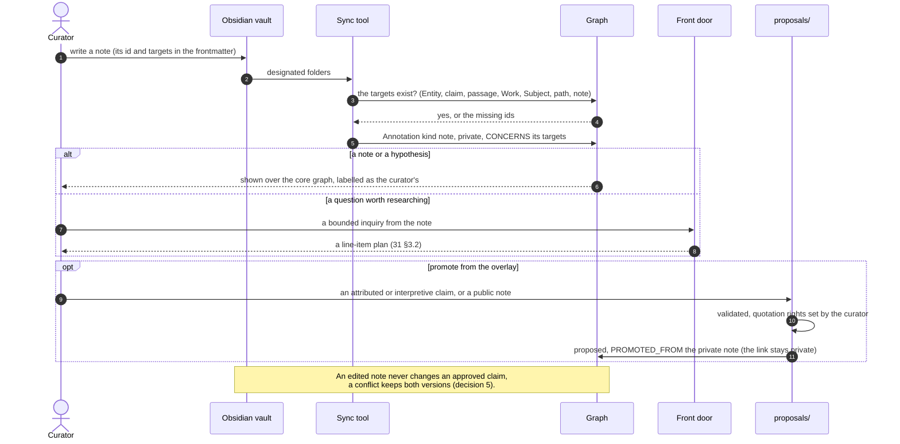

# 32 — The Research Workspace: Notes, Overlays, Saved Paths, and Status

**Date:** 2026-10-17. **Status:** the curator's decisions are recorded in
[docs/Addendum  Curator Experience, Notes, Content, and Overlay Layers.md](docs/Addendum%20%20Curator%20Experience%2C%20Notes%2C%20Content%2C%20and%20Overlay%20Layers.md)
(§1 here); how they map onto the model (§2) is proposed; nothing is built.
**Changes:** [02](02-GRAPH-MODEL.md) (what an Annotation may concern),
[06](06-GRAPH-NAVIGATION.md) §13 (path tracing defaults),
[26](26-UI-DATA-CONTRACT.md) (status labels, filters), [29](29-EVENT-CENTRED-INQUIRY.md)
§10 item 6 (where the curator's notes live), [31](31-ONE-COMMAND.md) §7 items 1
and 2 (settled).

## 1. Decisions (curator, 2026-10-17)

1. **The user is the curator**, for now. The design serves one
   researcher-curator building, exploring, annotating, and governing the graph;
   a simplified experience for other users does not drive it.
2. **Line-item plans, low friction.** The plan is shown before costly or
   graph-changing work; every item has a stable id and may be approved,
   rejected, modified, or deferred, with **approve all** for routine plans;
   every version is kept. A run stops only for a material identity ambiguity, a
   major widening of scope, rights, a destructive reconciliation, or the budget.
   (Settles 31 §7 item 1: guided, with approve all.)
3. **The primary use is writing a book on the Roman Republic**: finding
   non-obvious relationships several hops away, with meaningful content, not
   nodes and edges alone. Four content layers: core knowledge (entities and
   approved claims), source voices (attributed depictions and readings),
   explanatory content (descriptions, accounts), and the research workspace
   (notes, questions, hypotheses, excerpts, saved paths).
4. **Notes are research objects**, creatable and editable from Obsidian and
   from the graph interface, attachable to an Entity, a claim, a passage, a
   Work, a Subject, a Proposal, a saved path, or another note. A note on a claim
   comments on it without becoming one.
5. **Obsidian is an editing client, not the authority.** Neo4j holds entities,
   claims, evidence, and stable ids; Markdown may hold extended personal prose.
   A note's id is stable across renames; an edited note never changes an
   approved claim; conflicts keep both versions.
6. **A core pack and overlays.** The governed graph (approved and attributed
   claims, authorities, sources, cleared quotations, approved accounts) is the
   core; private and shared overlays hold notes, highlights, transcriptions,
   hypotheses, saved paths, and candidate relationships, referencing core ids
   rather than copying them. What a user sees is composed at read time.
7. **Promotion from an overlay is a transformation**, not a visibility toggle:
   proposed, reviewed for evidence and rights, edited into a public form,
   decided by the curator, and linked back to its private origin without
   exposing private text. A model never declares copyrighted text cleared.
8. **Saved paths** are research objects: the nodes and claims of a multi-hop
   discovery, who found it, why it may matter, notes. Saving a path asserts
   nothing.
9. **Proposed claims stay visible in the same projection as approved ones**
   (25 decision 2, confirmed), with unmistakable status, because fit can only
   be judged in context. (Settles 31 §7 item 2.)
10. **Path tracing is approved-only by default**, proposed-inclusive when the
    researcher asks; every hop states its status, and a path with proposed or
    interpretive hops is a research lead, never a factual chain.
11. **Status is encoded redundantly** (line style and a card label, never colour
    alone): APPROVED; PROPOSED — NOT REVIEWED; CONTESTED; REJECTED and
    SUPERSEDED in history only.
12. **Match before storing**: a candidate claim is compared with approved and
    proposed claim families before another edge is made (31 §3.5).

## 2. Onto the model (proposed)

### 2.1 Notes are Annotations

No new label. The Annotation (02, the eighth core label) already is
commentary, never a claim, with an author, visibility, and status. It gains:

- `kind: note` beside `passage-of-note` and `entity-mention`, with the
  addendum's note types (observation, question, hypothesis, interpretation,
  excerpt, outline, argument) and its own statuses (draft, active, endorsed,
  archived);
- **wider targets**: `CONCERNS` may point at an Entity, an Assertion, a
  Subject, a Proposal, another Annotation, or a saved path, not only an Entity;
  `ANNOTATES` keeps the passage and its quotation;
- `title`, `body` (Markdown), `modifiedAt`, `origin` (obsidian, graph-ui,
  import, agent) and `filePath`, and a `quotationStatus` (private copy, public
  domain, licensed, permission, review required) set by the curator, never by
  a model.

29 §10 item 6 (option c) becomes concrete: the vault is the editor, the note's
id sits in its frontmatter, and the graph holds the note with its targets; a
sync tool reads designated folders, and the graph interface can open the note's
Obsidian URI.

### 2.2 Saved paths are Annotations too

`kind: path`, an ordered list of node and claim ids, `generatedBy` (curator or
agent), an explanation, visibility, and notes; `CONCERNS` to the nodes on the
path. A saved path may become a research question, a source-discovery task, or
an agent's assignment to test the connection (31 §3).

### 2.3 Overlays are visibility and ownership

The core pack is graph content (claims by status, Works, authorities, accepted
and endorsed Annotations); an overlay is the Annotations, transcriptions, and
saved paths of one owner at a visibility. The read API composes them; nothing
is copied. The run state gains an owner and a visibility
([orchestration/contracts.py](orchestration/contracts.py)), so a run's
candidates and notes belong to a workspace.

### 2.4 Promotion from an overlay

A command turns a private note or transcription into proposals: an attributed
or interpretive claim with a cleared quotation, or an endorsed public note,
each linked `PROMOTED_FROM` the private Annotation (the link stays private).

### 2.5 In the explorer (26)

- Card labels by status as in decision 11; a proposed claim's card shows who
  proposed it, the inquiry and run, when, its evidence and qualifiers, its
  validation, the critic's verdict, and possible duplicates or conflicts.
- Filters: approved only; approved and proposed (the default research view);
  proposed only; contested; attributed; interpretive; history (rejected,
  superseded); private overlay; shared overlay. A publication view defaults to
  approved only.
- Path tracing (06 §13): approved-only by default; including proposed claims is
  a switch, and every hop's status is in the explanation.

### 2.6 The sequence (2026-10-17, handoff 1f2(g))

From the sequence-diagram review, adapted: the sync runs vault to graph first
(the recommendation in §3 item 3, still open), and promotion makes new
proposals rather than changing a note's visibility (decision 7). Nothing here
is built.

## 3. Open

1. **Visibility words.** Annotations use private, team, public; the addendum
   uses private, shared, public. Recommended: shared, renaming team (a
   migration of 71 Annotations).
2. **Saved paths as Annotations** (§2.2) or a label of their own. Recommended:
   Annotations, until a query needs more.
3. **Which way sync runs first**: vault to graph only (notes written in
   Obsidian appear in the graph), or both ways from the start. Recommended: vault
   to graph first.
