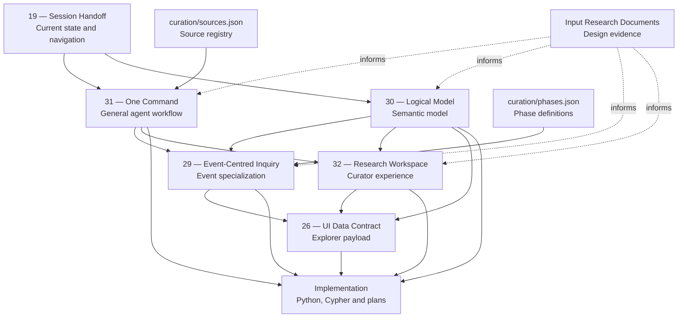
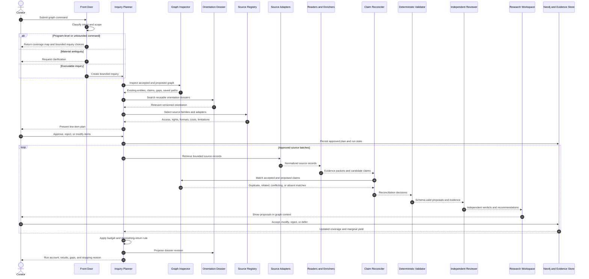
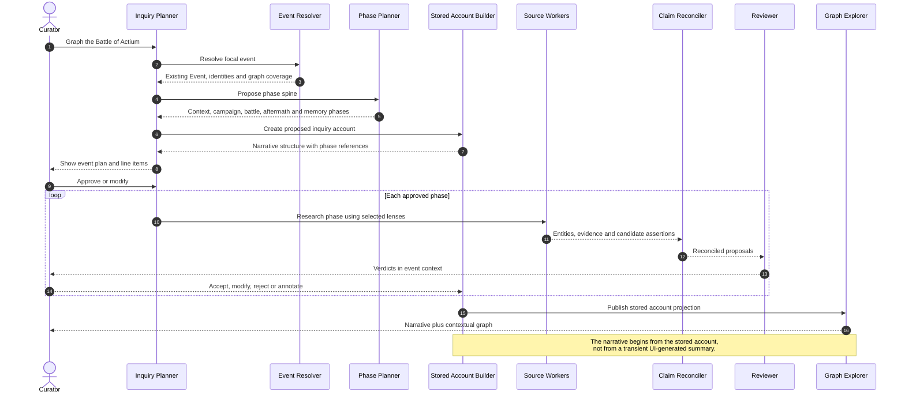
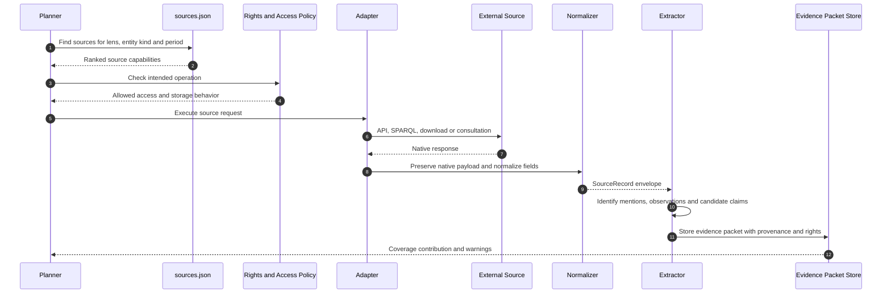
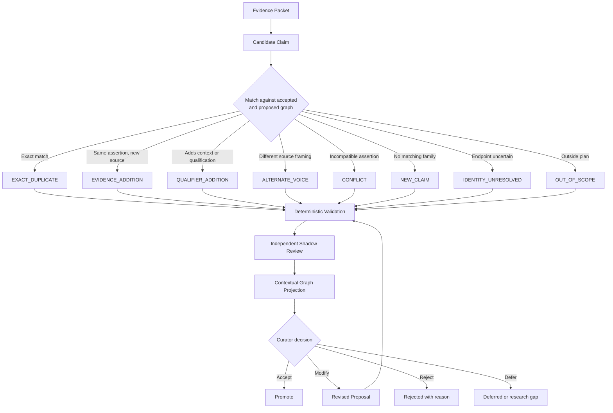
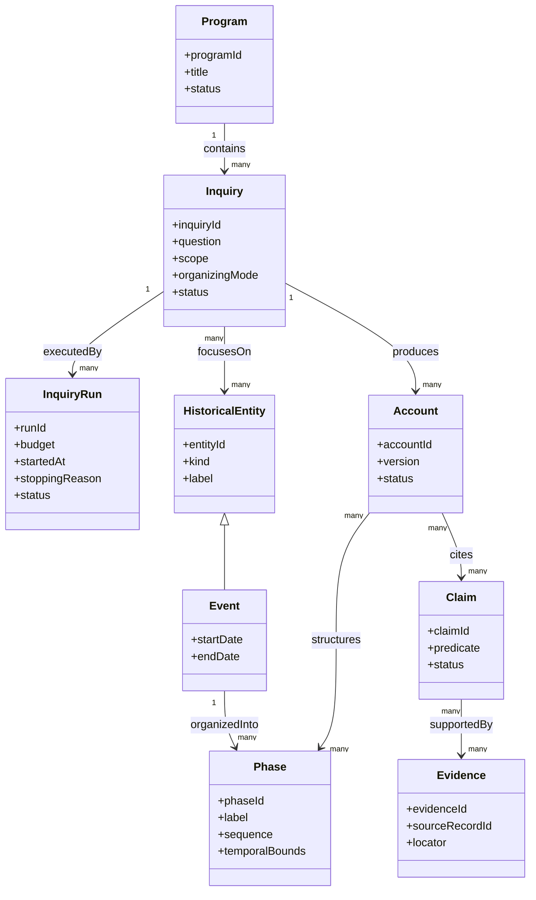

Sequence Diagram
Your proposed reading order is coherent, but I would change the language from **“what governs, in reading order”** to two separate concepts: **reading order** and **authority precedence**. They should not be identical.

I cannot verify the actual contents behind the `vscode-webview://` links because those are local VS Code session addresses, not repository URLs. The assessment below therefore checks the architecture represented by your list, not line-by-line consistency inside the linked files. If you provide GitHub URLs or upload the documents, I can perform the actual cross-document audit.

## Recommended document hierarchy

| Order | Document                      | Proper role                                                                       | Normative authority                                               |
| ----: | ----------------------------- | --------------------------------------------------------------------------------- | ----------------------------------------------------------------- |
|     1 | `19-SESSION-HANDOFF.md`       | Entry point, current state, open decisions, implementation status, and next steps | **Informational**, except for explicitly recorded decisions       |
|     2 | `31-ONE-COMMAND.md`           | Governing end-to-end agent workflow                                               | **Normative for orchestration and agent behavior**                |
|     3 | `30-LOGICAL-MODEL.md`         | Governing semantic and data model                                                 | **Normative for concepts, identities, states, and relationships** |
|     4 | `29-EVENT-CENTRED-INQUIRY.md` | Event-specific specialization of the general workflow                             | **Normative within event inquiries**                              |
|     5 | `32-RESEARCH-WORKSPACE.md`    | Curator/user workflow and research experience                                     | **Normative for workspace behavior**                              |
|     6 | `26-UI-DATA-CONTRACT.md`      | Boundary between stored model and explorer                                        | **Normative for API/view payloads**                               |
|     — | Input research documents      | Rationale and design evidence                                                     | **Informative, not governing**                                    |
|     — | Python, JSON, Cypher, plans   | Current implementation                                                            | Must conform to governing documents                               |

### Important correction

`19-SESSION-HANDOFF.md` should be read first, but it should **not be the highest architectural authority**. A handoff document changes frequently and can contain incomplete work, temporary conclusions, and implementation notes.

The actual governing center should be:

```text
31-ONE-COMMAND.md       governs behavior
30-LOGICAL-MODEL.md     governs meaning and stored structure
32-RESEARCH-WORKSPACE.md governs curator interaction
26-UI-DATA-CONTRACT.md  governs presentation boundaries
29-EVENT-CENTRED-INQUIRY.md specializes 31 for events
```

The handoff tells the next developer where the project stands relative to those specifications.

## Reading order

For a new developer, your proposed reading order mostly works:

1. `19-SESSION-HANDOFF.md`
2. `29-EVENT-CENTRED-INQUIRY.md`
3. `31-ONE-COMMAND.md`
4. `32-RESEARCH-WORKSPACE.md`
5. `26-UI-DATA-CONTRACT.md`
6. `30-LOGICAL-MODEL.md`

However, I would move `31-ONE-COMMAND.md` before `29-EVENT-CENTRED-INQUIRY.md`. The developer should understand the general agent workflow before reading its event-specific application.

### Revised reading order

1. **Session handoff** — Where are we?
2. **One command** — What does the system do?
3. **Logical model** — What objects and states exist?
4. **Event-centred inquiry** — How is the general model applied to Actium?
5. **Research workspace** — How does the curator work with it?
6. **UI data contract** — What does the explorer receive?
7. **Code and data** — What has actually been implemented?

This sequence moves from purpose to semantics to specialization to experience to implementation.

## Authority precedence

When two documents conflict, the project needs a deterministic precedence rule. I suggest:

```text
Recorded architectural decision
        ↓
30-LOGICAL-MODEL.md for semantic conflicts
31-ONE-COMMAND.md for behavioral conflicts
        ↓
29-EVENT-CENTRED-INQUIRY.md for event specialization
32-RESEARCH-WORKSPACE.md for curator interaction
26-UI-DATA-CONTRACT.md for interface representation
        ↓
Implementation code and configuration
        ↓
19-SESSION-HANDOFF.md
        ↓
Research inputs and exploratory notes
```

There is no universal precedence between documents 30 and 31:

- If the disagreement concerns what a `Claim`, `Inquiry`, `Account`, `Phase`, or `Proposal` means, document 30 governs.
- If it concerns which agent runs, in what order, with what review and stopping behavior, document 31 governs.
- If an event inquiry introduces a specialization not covered by 31, document 29 governs—but it should not contradict 31 without recording an explicit architectural decision.

## Document dependency flow



The dotted edges are important: source reviews and architectural discussions **inform** the specification but do not govern production behavior directly.

## End-to-end sequence

This is the sequence diagram I would place in `31-ONE-COMMAND.md`.



## Event inquiry sequence

This belongs in `29-EVENT-CENTRED-INQUIRY.md`. It shows how the general process specializes for Actium.



## Internal source sequence

The source review and `curation/sources.json` should feed the agent through a controlled registry rather than through prompt instructions. The source inventory distinguishes APIs, bulk downloads, structured editions, linked data, and consultative browser resources; it also distinguishes rights to retrieve, store, index, quote, and redistribute. [Agent resources.md](Agent%20resources.md)



## Proposal review flow

This belongs across `31-ONE-COMMAND.md`, `32-RESEARCH-WORKSPACE.md`, and `views/review-status.cypher`.



## Workspace and private overlay

This should appear in `32-RESEARCH-WORKSPACE.md`.

```mermaid
sequenceDiagram
    autonumber

    actor Curator
    participant Obsidian
    participant Workspace
    participant Graph
    participant Planner
    participant Review

    Curator->>Obsidian: Write note or excerpt
    Obsidian->>Workspace: Synchronize note with target identifier

    Workspace->>Graph: Resolve node, claim, Work, passage or saved path
    Graph-->>Workspace: Stable target and contextual neighborhood

    Workspace->>Workspace: Store private overlay annotation

    alt Note only
        Workspace-->>Curator: Display note over core graph
    else Hypothesis
        Workspace-->>Curator: Mark as private hypothesis
    else Request graph expansion
        Workspace->>Planner: Create bounded inquiry from note
        Planner-->>Curator: Present line-item plan
    end

    Planner->>Review: Produce and review proposals
    Review-->>Workspace: Proposed additions in context

    Curator->>Workspace: Select material for promotion
    Workspace->>Workspace: Create governed public form
    Workspace->>Graph: Submit reviewed proposal

    Note over Workspace,Graph: Promotion creates a governed graph object;<br/>it does not merely change a visibility flag.
```

## Model consistency checks

Based on the document descriptions, these are the specific consistency questions the developer should answer.

| Question | Documents/code to compare |
|---|---|
| Is an `Event` the inquiry itself, or the focus of an `Inquiry`? | 29 vs. 30 vs. `contracts.py` |
| Is the stored `Account` an entity, document, projection, or versioned narrative artifact? | 29 §4a vs. 26 vs. 30 |
| Are phases graph objects, configuration records, or both? | 29 §10, `phases.json`, `event_phases.py`, 30 |
| Are proposed claims stored in Neo4j or a separate proposal store? | 30, 32, `review-status.cypher` |
| Can proposed claims participate in pathfinding by default? | 32 vs. 26 |
| Does the UI receive raw claims or already assembled graph projections? | 26 vs. 30 |
| Does the narrative account reference claim IDs, evidence IDs, or only entities and phases? | 26, 29, 30 |
| Are notes allowed on native Neo4j relationships, or only on reified claims/assertions? | 30 vs. 32 |
| Is the orientation dossier a graph object, document artifact, or orchestration record? | 31 vs. 30 |
| Does `sources.json` govern source capability, rights, access, and adapter selection separately? | 31 vs. `sources.json` |
| Are independent witnesses represented as source records, evidence objects, or source traditions? | 31 vs. 30 |
| Does the reviewer return advice only, with no promotion transition? | 31, 32, `contracts.py` |
| Are program, inquiry, and run represented distinctly? | 31 vs. 30 vs. `contracts.py` |
| Can one inquiry contain multiple focal events? | 29 vs. general workflow |
| Does every status used by the UI exist in the logical model and Cypher view? | 26, 30, `review-status.cypher` |

## Likely modeling issue

The phrase **“the event as the inquiry”** deserves scrutiny.

It can mean either:

```text
Event = Inquiry
```

or:

```text
Inquiry --FOCUSES_ON--> Event
```

The second is safer.

The Battle of Actium is a historical entity. An inquiry about Actium is a research activity with scope, budget, lenses, plans, source selections, runs, stopping conditions, and curator decisions. Several distinct inquiries may focus on the same event:

- The naval campaign.
- Coalition networks.
- Ship technology.
- Augustan commemoration.
- Ancient narrative traditions.
- Archaeology of the victory monument.

Therefore, the logical model should not collapse the event and inquiry into one object.



## Stored account concern

The stored account should not become a second uncontrolled truth layer. It should be a **versioned narrative assembly** that references claims, evidence, phases, entities, and source voices.

A paragraph in the account should be traceable to:

```text
AccountSection
    → Phase
    → Claim
    → Evidence
    → SourceRecord
```

Interpretive prose may exceed any one claim, but it must be marked as authored synthesis and remain distinguishable from quoted or paraphrased source content.

The explorer can then start from the account while allowing the curator to move outward into the graph and evidence.

## Phase-model concern

`curation/phases.json` and `discovery/event_phases.py` should not imply that every event receives a rigid chronological template. The phase service should propose an ordered or partially ordered phase plan when chronology is appropriate.

For Actium, the phases might include:

```text
Political rupture
    → Coalition formation
    → Strategic preparation
    → Agrippa's maritime campaign
    → Encampment and blockade
    → Battle
    → Surrender and pursuit
    → Alexandria
    → Settlement and commemoration
```

Some event inquiries may use overlapping phases, uncertain boundaries, or thematic rather than strictly sequential structures. The logical model should therefore support:

- `PRECEDES`
- `OVERLAPS`
- `PART_OF`
- `ALTERNATIVE_TO`
- `TEMPORALLY_UNCERTAIN`
- `PHASE_OF_ACCOUNT`

A phase plan may be an inquiry structure before it becomes an approved historical structure.

## Recommended document headers

Every governing document should begin with metadata like:

```yaml
---
document_id: CHR-ARCH-031
title: One Command
status: governing
authority_scope:
  - agent orchestration
  - source selection
  - review workflow
supersedes:
  - CHR-ARCH-OLD-CONCIERGE
depends_on:
  - CHR-MODEL-030
specialized_by:
  - CHR-METHOD-029
implemented_by:
  - orchestration/contracts.py
  - curation/sources.json
last_reviewed: 2026-10-17
open_decisions: []
---
```

This removes ambiguity about whether a document is governing, explanatory, superseded, or merely an input.

## Recommended decision register

The seven decisions developed in the addendum should not remain embedded only in narrative documents. Create a compact decision register:

| ID | Decision |
|---|---|
| ADR-001 | User and curator are presently the same role; guided approval is the default |
| ADR-002 | Approved and proposed claims appear in one contextual graph projection |
| ADR-003 | Local Subjects may be created when authority vocabularies lack the needed compound concept |
| ADR-004 | Orientation dossiers persist as versioned research assets |
| ADR-005 | Independent reviewers operate in shadow mode without promotion authority |
| ADR-006 | Source discovery begins with a budget and stops on measured diminishing returns |
| ADR-007 | Chronology is used when explanatory, not imposed on abstract inquiries |
| ADR-008 | Broad commands become Programs and bounded Inquiries rather than unbounded runs |

Each ADR should record:

- Decision.
- Rationale.
- Consequences.
- Alternatives rejected.
- Documents affected.
- Code affected.
- Date.
- Status.

## Developer handoff checklist

Before implementation continues, the developer should verify:

1. `contracts.py` contains distinct `Program`, `Inquiry`, `InquiryRun`, `PlanItem`, `OrientationDossier`, `EvidencePacket`, `Proposal`, and `ReviewerVerdict` contracts.
2. `sources.json` describes retrieval capability separately from legal permission.
3. `phases.json` represents phase templates or proposals—not universal historical facts.
4. `event_phases.py` generates a proposed structure and does not directly promote phases.
5. `review-status.cypher` returns accepted and proposed claims together with explicit status.
6. The UI contract includes stable identifiers for annotations and saved paths.
7. The stored account references claims and evidence rather than duplicating historical statements as unaudited prose.
8. The reviewer cannot invoke a promotion transition.
9. Source batches record marginal yield and stopping reasons.
10. The implementation emits state transitions that can be resumed after interruption.

The architecture is now internally plausible. The highest-priority audit is the boundary among **Event, Inquiry, Phase Plan, approved Phase, and stored Account**. If those five objects are cleanly distinguished, the rest of the orchestration and UI flow becomes much easier to implement correctly.